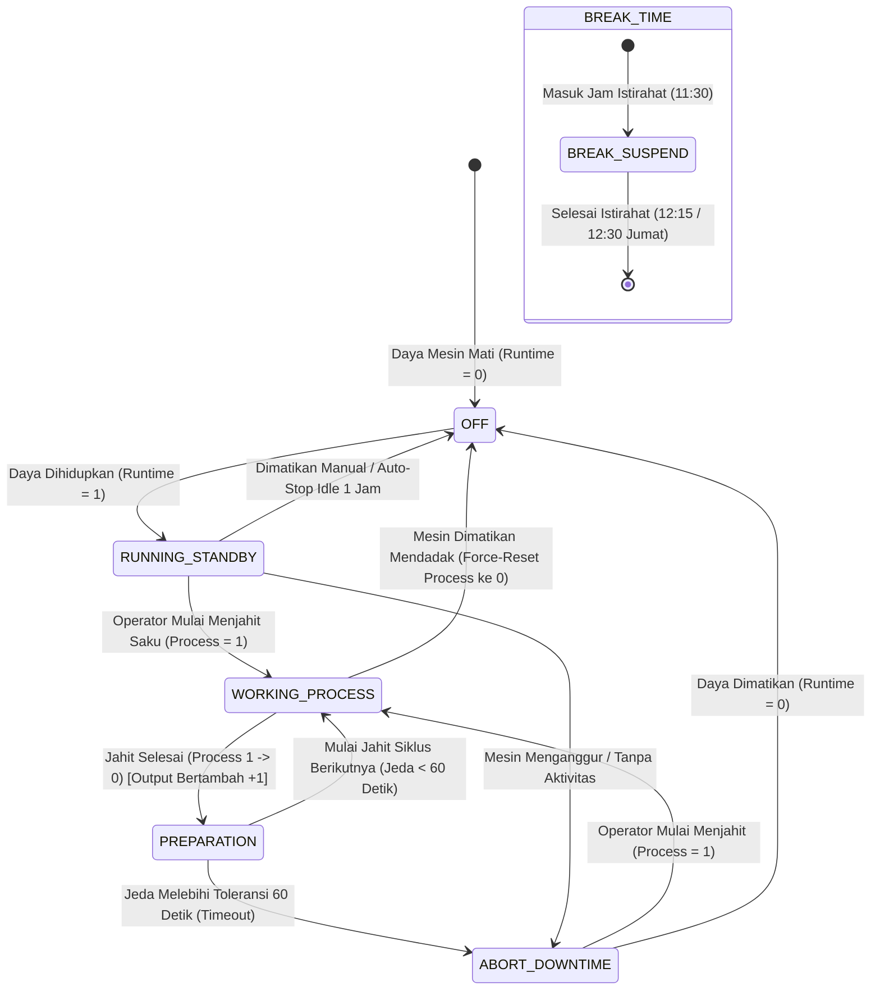
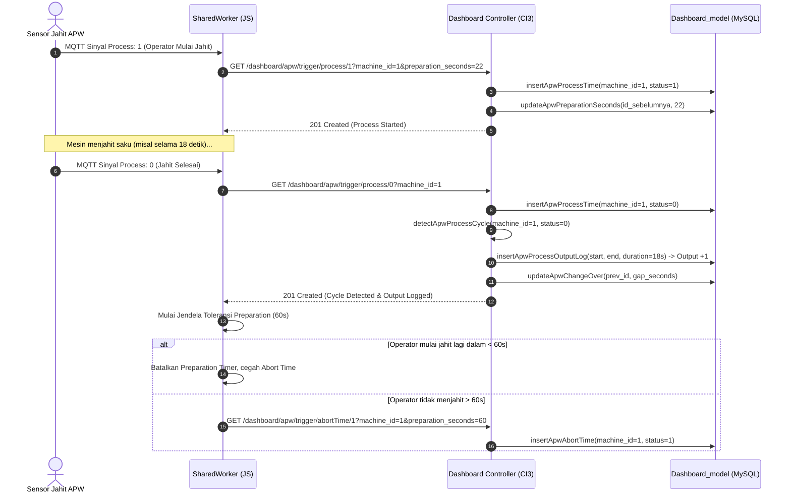
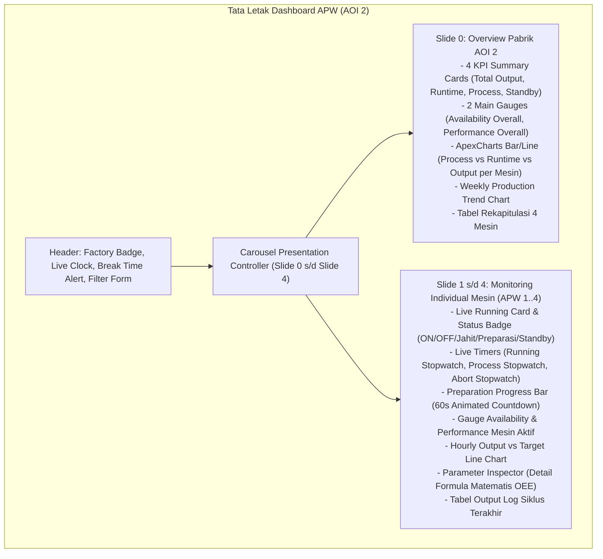

# Panduan Komprehensif & Cara Kerja Program APW (Auto Pocket Welt) - AOI 2

Dokumen ini menjelaskan secara menyeluruh arsitektur teknis, alur data (*end-to-end data pipeline*), arsitektur *SharedWorker* MQTT & *broker reconciliation*, struktur basis data, mesin deteksi siklus produksi otomatis (*Automatic Cycle Detection*), formulasi matematis KPI (*Availability*, *Performance*, *Ideal Cycle Time*), penanganan jam istirahat (*Break Time*), fitur proteksi *Auto-Stop Idle 1 Jam*, hingga implementasi antarmuka dashboard pada modul **APW (Auto Pocket Welt)** di sistem Dashboard HTU AOI (**Apparel One Indonesia - Factory AOI 2**).

---

## 1. Ringkasan Eksekutif & Konsep Dasar

Modul **APW (Auto Pocket Welt)** pada aplikasi HTU AOI dirancang khusus untuk memantau aktivitas operasional, produktivitas, dan efisiensi mesin pembuat kantong otomatis (*Automatic Pocket Welter Machines*) di lini produksi garmen **Pabrik AOI 2** secara langsung (*real-time*).

### Tujuan Utama Sistem:
1. **Real-time Utilization & State Tracking:** Memantau status hidup/mati daya mesin (*Running/Runtime*), status aktivitas menjahit saku (*Process Time*), jendela toleransi persiapan operator (*Preparation Time* 60 detik), serta waktu henti/menganggur (*Abort/Downtime*).
2. **Automatic Cycle & Output Detection:** Menghitung jumlah kantong/garmen yang selesai dijahit (*Output Count*), durasi proses jahit per siklus (*Process Duration*), dan jeda pergantian antar-siklus (*Change Over Time*) tanpa memerlukan intervensi input manual dari operator.
3. **Analitik KPI & OEE Terintegrasi:** Mengkalkulasi metrik efisiensi utama seperti **Availability Rate (%)**, **Performance Rate (%)**, **Ideal Cycle Time (detik/pcs)**, dan **Output per Jam (Hourly Output vs Target Line)**.
4. **Persistent MQTT Engine via SharedWorker:** Memastikan penerimaan sinyal MQTT dari PLC/Broker EMQX tidak terputus dan tidak terjadi duplikasi pemicuan trigger (*idempotent trigger*), bahkan ketika tab dashboard ditutup atau pengguna berpindah halaman.
5. **Smart Production Guards:** Mengimplementasikan proteksi otomatis terhadap jam istirahat resmi (*Break Time Protection*), penyesuaian khusus hari Jumat (*Friday Extended Shift & Break Detection*), serta pemutusan daya otomatis saat mesin dibiarkan menyala tanpa proses selama 1 jam (*Auto-Stop Idle 1 Hour*).

---

## 2. Pemetaan Mesin & Cakupan Pabrik (Factory AOI 2)

Sistem APW beroperasi khusus pada fasilitas produksi **AOI 2** dengan konfigurasi 4 unit mesin master:

| Pabrik (Factory) | Modul | Jumlah Mesin | Database `machine_id` | Nama Tampilan (UI) | Lokasi / Lini | Target Default Shift |
|---|---|:---:|:---:|---|---|:---:|
| **AOI 2** | **APW (Auto Pocket Welt)** | **4 Mesin** | `1` | Mesin APW 1 | Auto Pocket Welt Line 1 | 800 pcs |
| | | | `2` | Mesin APW 2 | Auto Pocket Welt Line 2 | 800 pcs |
| | | | `3` | Mesin APW 3 | Auto Pocket Welt Line 3 | 800 pcs |
| | | | `4` | Mesin APW 4 | Auto Pocket Welt Line 4 | 800 pcs |

> [!NOTE]
> Seluruh mesin APW dialokasikan pada database dengan `machine_id` 1 sampai 4. Akses konfigurasi target shift hanya diizinkan untuk pengguna yang memiliki sesi login aktif dengan atribut pabrik **AOI 2**.

---

## 3. Arsitektur Sistem & Aliran Data End-to-End

Berikut adalah bagan alir arsitektur lengkap dari sinyal hardware/PLC mesin hingga visualisasi data di dashboard:

```mermaid
flowchart TD
    subgraph HARDWARE_LAYER["1. Hardware & PLC / Gateway Layer (Shop Floor AOI 2)"]
        PLC["PLC Mesin APW 1 - 4"]
        S_RUN["Relay Status Daya Mesin (Runtime ON / OFF)"]
        S_PROC["Sensor Jahit Kantong (Process ON / OFF)"]
        S_FRI["Sensor / Scheduler Status Hari Jumat"]
        PLC --> S_RUN
        PLC --> S_PROC
        PLC --> S_FRI
    end

    subgraph BROKER_LAYER["2. MQTT Message Broker (EMQX Broker)"]
        EMQX["EMQX Broker (ws://localhost:8083/mqtt)"]
        S_RUN -->|Pub QoS 1| T_RUN["data/apw/runtime{1..4}/+"]
        S_PROC -->|Pub QoS 1| T_PROC["data/apw/process{1..4}/+"]
        S_FRI -->|Pub QoS 1| T_FRI["data/apw/friday/+"]
        T_RUN --> EMQX
        T_PROC --> EMQX
        T_FRI --> EMQX
    end

    subgraph WORKER_LAYER["3. Client Persistent Engine (SharedWorker & Connector)"]
        CONN["Global Connector (apw-mqtt-connector.js)"]
        SW["SharedWorker (apw-mqtt-worker.js)"]
        RECON["State Reconciliation Engine (GET apwGetLatestStatus)"]
        EDGE["Edge Detector & Heartbeat Filter"]
        QUEUE["Per-Machine Sequential FIFO Task Queue"]
        PREP_TIMER["Preparation Timer (60s Countdown)"]
        AUTO_STOP["Auto-Stop Idle 1 Jam Guard"]
        BREAK_GUARD["Break Time Checker (11:30 - 12:15/12:30)"]

        EMQX <-->|WebSocket Persistent| SW
        CONN -.->|Hold Port Alive| SW
        SW --> RECON
        SW --> EDGE
        EDGE --> QUEUE
        EDGE --> PREP_TIMER
        EDGE --> AUTO_STOP
        EDGE --> BREAK_GUARD
    end

    subgraph BACKEND_LAYER["4. Backend Ingestion & Processing (CI3 Dashboard.php)"]
        CTRL["Dashboard.php Controller"]
        QUEUE -->|GET /dashboard/apw/trigger/runtime/{0,1}| CTRL
        QUEUE -->|GET /dashboard/apw/trigger/process/{0,1}| CTRL
        QUEUE -->|GET /dashboard/apw/trigger/abortTime/{0,1}| CTRL
        
        CTRL --> GUARDS["Business Rules: Idempotency & Runtime Dependency"]
        CTRL --> CYCLE["Cycle Detection (1 -> 0 Falling Edge)"]
        CTRL --> CALC_PREP["Simpan preparation_seconds (Max 60s)"]
        CTRL --> CALC_CO["Hitung change_over_seconds"]
        CTRL --> SYNC_ABORT["Auto Sync Abort State & Duration"]
    end

    subgraph DB_LAYER["5. Database Persistence Layer (MySQL)"]
        DBM["Dashboard_model.php"]
        CTRL --> DBM
        DBM --> TAB_MACH[("apw_machine")]
        DBM --> TAB_RUN[("apw_running_time")]
        DBM --> TAB_PROC[("apw_process_time")]
        DBM --> TAB_OUT[("apw_process_output_log")]
        DBM --> TAB_ABORT[("apw_abort_time")]
        DBM --> TAB_TGT[("apw_shift_target")]
    end

    subgraph PRESENTATION_LAYER["6. Presentation & Dashboard UI Layer (apw.php)"]
        SW -->|Broadcast Event PostMessage| UI_EVENT["Live State & Timer Handlers"]
        DBM -->|GET /dashboard/apw/getChartData| UI_POLL["Data Poller (Chart & Stats Engine)"]
        UI_EVENT --> UI_CARDS["Status Cards & Live Timers"]
        UI_POLL --> UI_CHARTS["ApexCharts, ECharts Gauges, Parameter Inspector"]
        UI_POLL --> UI_CAROUSEL["Auto-Carousel Slide 0 (Overview) & Slide 1..4 (Per-Mesin)"]
    end
```

---

## 4. Mesin Status (State Machine) Operasional APW

Setiap mesin APW bergerak di antara 5 status operasional utama dengan aturan transisi yang ketat:



### Rincian 5 Status Mesin APW:
1. **OFF (Mati / Daya Padam):**
   - Nilai: `Runtime = 0`.
   - Motor servo dan daya utama mesin mati. Seluruh timer proses dan abort dihentikan.
2. **RUNNING / STANDBY (Menyala Siaga):**
   - Nilai: `Runtime = 1`, `Process = 0`, `Abort = 0`.
   - Mesin hidup dan siap menerima kain/pola kantong.
3. **WORKING / PROCESS (Sedang Menjahit Saku):**
   - Nilai: `Runtime = 1`, `Process = 1`, `Abort = 0`.
   - Mesin sedang aktif melipat, memotong, dan menjahit saku. Timer proses berjalan. Status *Abort* otomatis dimatikan.
4. **PREPARATION (Masa Toleransi Persiapan 60 Detik):**
   - Nilai: Terjadi tepat saat sinyal jahit selesai (`Process 1 -> 0`).
   - Operator diberikan waktu toleransi **60 detik** untuk mengambil garmen selesai dan memposisikan bahan kantong baru ke meja APW.
   - Masa persiapan ini **tetap dihitung sebagai waktu kerja produktif** (termasuk dalam komponen *Availability*), bukan kerugian waktu *downtime*.
5. **ABORT / STANDBY DOWNTIME (Waktu Henti / Menganggur):**
   - Nilai: `Runtime = 1`, `Process = 0`, `Abort = 1`.
   - Aktif secara otomatis apabila masa persiapan operator melebihi 60 detik (*Preparation Timeout*), atau mesin menyala tanpa aktivitas jahit.
   - **Pengecualian Jam Istirahat:** Selama jam 11:30 - 12:15 (atau 12:30 pada hari Jumat), status abort otomatis dinonaktifkan agar tidak merusak metrik efisiensi operator.

---

## 5. Arsitektur Persistent SharedWorker & MQTT Engine

Salah satu keunggulan teknis sistem APW adalah pemisahan logika ingestion MQTT dari siklus hidup (*lifecycle*) halaman web browser menggunakan **HTML5 SharedWorker**.

### Mengapa Menggunakan SharedWorker?
Jika koneksi MQTT dikelola langsung oleh JavaScript di dalam halaman tab (`window`), saat operator me-refresh halaman, berpindah ke menu lain, atau menutup tab, koneksi broker terputus dan status jahit yang terjadi di lapangan akan hilang atau tidak tercatat ke database.

```mermaid
flowchart LR
    subgraph BROWSER_TABS["Tab Browser Operator"]
        TAB1["Tab 1: Dashboard APW (apw.php)"]
        TAB2["Tab 2: Detail Log (apw_detail_log.php)"]
        TAB3["Tab 3: Menu Performance / Direct"]
    end

    subgraph CONNECTOR["Global Background Connector"]
        CONN["assets/js/apw-mqtt-connector.js"]
    end

    subgraph PERSISTENT_WORKER["SharedWorker (assets/js/apw-mqtt-worker.js)"]
        MQ_CLI["MQTT Client (WebSocket Port 8083)"]
        FIFO["Per-Machine Task Queue (Promise FIFO)"]
        STATE_MGR["Local State & Timers Cache"]
    end

    TAB1 <-->|MessagePort| PERSISTENT_WORKER
    TAB2 <-->|MessagePort| PERSISTENT_WORKER
    TAB3 --> CONN <-->|MessagePort (Keep-Alive)| PERSISTENT_WORKER
    MQ_CLI --> FIFO --> STATE_MGR
```

### Mekanisme Kerja Utama Worker (`apw-mqtt-worker.js`):
1. **Global Connector (`apw-mqtt-connector.js`):**
   - Dimuat pada seluruh template aplikasi (`templates/header.php`).
   - Bertindak sebagai penahan (*anchor*) agar browser tidak mematikan *SharedWorker* meskipun tab APW sedang tidak dibuka.
2. **State Reconciliation saat Startup (`doReconciliation`):**
   - Saat worker pertama kali hidup, ia memanggil API backend `GET /dashboard/apwGetLatestStatus`.
   - Mengambil status runtime dan process terakhir yang tersimpan di MySQL untuk masing-masing mesin (1..4).
   - Membandingkan status DB dengan pesan MQTT yang masuk untuk menyinkronkan baseline tanpa memicu duplikasi data (*ghost triggers*).
3. **Per-Machine Sequential FIFO Task Queue (`enqueueMachineTask`):**
   - Menggunakan rantai `Promise` berurutan per ID mesin.
   - Memastikan request HTTP trigger ke backend dieksekusi secara teratur: trigger `runtime/1` dijamin selesai tersimpan di backend sebelum trigger `process/1` dikirimkan.
4. **Heartbeat Filtering & Edge Detection:**
   - PLC/Gateway mengirim status setiap beberapa ratus milidetik (heartbeat).
   - Worker hanya memproses pesan jika terjadi perubahan nilai nyata (*Falling Edge* `1 -> 0` atau *Rising Edge* `0 -> 1`).
5. **Retained Message Handling:**
   - Pesan bertipe *retained* dari broker MQTT hanya digunakan untuk inisialisasi visual state awal, dan tidak memicu panggilan trigger ganda ke backend.

---

## 6. Fitur Cerdas: Proteksi Jam Istirahat & Auto-Stop Idle 1 Jam

### A. Proteksi Jam Istirahat Resmi (Break Time Protection)
Sistem memiliki jadwal istirahat resmi yang otomatis dikenali oleh backend dan *SharedWorker*:

| Hari | Jam Istirahat | Durasi | Penyesuaian Sistem |
|---|:---:|:---:|---|
| **Senin – Kamis** | `11:30:00 – 12:15:00 WIB` | 45 Menit | Abort Time otomatis dinonaktifkan; durasi istirahat dikurangi dari total waktu kotor. |
| **Jumat** | `11:30:00 – 12:30:00 WIB` | 60 Menit | Diperpanjang khusus ibadah Jumat; deteksi otomatis via waktu lokal atau MQTT topic `data/apw/friday/+`. |

- **Logika Otomatis:**
  - Saat jam 11:30 tercapai, *SharedWorker* menghentikan status *Abort Time* pada semua mesin yang menyala.
  - Jika operator tidak menjahit selama jam istirahat, waktu tersebut **tidak dihitung sebagai downtime/kerugian kerja**.
  - Saat jam istirahat berakhir (12:15 / 12:30), jika mesin masih menyala dan belum ada proses jahit baru, *Abort Time* dilanjutkan secara otomatis.

### B. Auto-Stop Running Time (Idle 1 Jam Tanpa Jahit)
Untuk mencegah kasus mesin lupa dimatikan saat awal shift atau mesin ditinggalkan menyala tanpa produksi:
1. Jika daya mesin dinyalakan (`Runtime = 1`), sebuah timer hitung mundur **1 jam (3600 detik)** diaktifkan.
2. Jika dalam 1 jam tidak ada satu pun sinyal jahit (`Process = 1`) yang masuk pada shift tersebut, sistem akan memicu *Auto-Stop Trigger* (`runtime/0`) untuk mematikan status mesin di sistem.
3. **One-Shot Guard per Shift:** Begitu sinyal `Process = 1` pertama diterima oleh salah satu mesin pada shift tersebut, fitur auto-stop otomatis dinonaktifkan (*disabled*) untuk sisa durasi shift berjalan.

---

## 7. Struktur Basis Data (Database Schema)

Modul APW didukung oleh 6 tabel utama di MySQL:

### A. Tabel `apw_machine` (Master Data Mesin)
Menyimpan daftar mesin APW yang terdaftar di lini produksi AOI 2.
```sql
CREATE TABLE `apw_machine` (
  `id` INT(11) NOT NULL AUTO_INCREMENT,
  `machine_name` VARCHAR(100) NOT NULL COMMENT 'Nama Mesin (mis: Mesin APW 1)',
  `description` VARCHAR(255) NULL DEFAULT NULL COMMENT 'Lokasi Lini (mis: Auto Pocket Welt Line 1)',
  `created_at` DATETIME NOT NULL DEFAULT CURRENT_TIMESTAMP,
  `updated_at` DATETIME NOT NULL DEFAULT CURRENT_TIMESTAMP ON UPDATE CURRENT_TIMESTAMP,
  PRIMARY KEY (`id`)
) ENGINE=InnoDB DEFAULT CHARSET=utf8mb4 COLLATE=utf8mb4_unicode_ci;
```

### B. Tabel `apw_running_time` (Log Daya Mesin)
Mencatat riwayat hidup/mati daya listrik pada masing-masing mesin APW.
```sql
CREATE TABLE `apw_running_time` (
  `id` INT(11) NOT NULL AUTO_INCREMENT,
  `machine_id` INT(11) NOT NULL DEFAULT 1 COMMENT 'Relasi ke apw_machine.id (1..4)',
  `status` TINYINT(1) NOT NULL DEFAULT 0 COMMENT '0: OFF/Stop, 1: ON/Running',
  `runtime_status` TINYINT(1) NULL DEFAULT NULL COMMENT 'Kolom kompatibilitas fallback',
  `created_at` DATETIME NOT NULL COMMENT 'Waktu event status tercatat',
  PRIMARY KEY (`id`),
  KEY `idx_machine_created` (`machine_id`, `created_at`),
  KEY `idx_created_at` (`created_at`)
) ENGINE=InnoDB DEFAULT CHARSET=utf8mb4 COLLATE=utf8mb4_unicode_ci;
```

### C. Tabel `apw_process_time` (Log Aktivitas Jahit Saku)
Mencatat transisi mulai (`1`) dan selesai (`0`) saat jarum mesin APW menjahit kantong.
```sql
CREATE TABLE `apw_process_time` (
  `id` INT(11) NOT NULL AUTO_INCREMENT,
  `machine_id` INT(11) NOT NULL DEFAULT 1 COMMENT 'Relasi ke apw_machine.id (1..4)',
  `status` TINYINT(1) NOT NULL DEFAULT 0 COMMENT '0: Reset/Stop, 1: Aktif Jahit',
  `created_at` DATETIME NOT NULL COMMENT 'Waktu event status tercatat',
  PRIMARY KEY (`id`),
  KEY `idx_machine_created` (`machine_id`, `created_at`),
  KEY `idx_created_at` (`created_at`)
) ENGINE=InnoDB DEFAULT CHARSET=utf8mb4 COLLATE=utf8mb4_unicode_ci;
```

### D. Tabel `apw_process_output_log` (Log Output Garmen & Siklus Selesai)
Tabel transaksi utama yang merekam setiap 1 pcs saku selesai dijahit beserta durasi jahit murni, jeda persiapan, dan jeda antar-siklus.
```sql
CREATE TABLE `apw_process_output_log` (
  `id` INT(11) NOT NULL AUTO_INCREMENT,
  `machine_id` INT(11) NOT NULL DEFAULT 1 COMMENT 'Relasi ke apw_machine.id (1..4)',
  `process_start` DATETIME NOT NULL COMMENT 'Waktu mulai jahit siklus ini',
  `process_end` DATETIME NOT NULL COMMENT 'Waktu selesai jahit siklus ini',
  `process_time_seconds` INT(11) NOT NULL DEFAULT 0 COMMENT 'Durasi jahit murni (detik)',
  `change_over_seconds` INT(11) NULL DEFAULT 0 COMMENT 'Jeda waktu dari siklus sebelumnya (detik)',
  `preparation_seconds` INT(11) NULL DEFAULT NULL COMMENT 'Waktu persiapan operator aktual (max 60s)',
  `created_at` DATETIME NOT NULL DEFAULT CURRENT_TIMESTAMP,
  PRIMARY KEY (`id`),
  KEY `idx_machine_process_end` (`machine_id`, `process_end`),
  KEY `idx_process_end` (`process_end`),
  KEY `idx_created_at` (`created_at`)
) ENGINE=InnoDB DEFAULT CHARSET=utf8mb4 COLLATE=utf8mb4_unicode_ci;
```

### E. Tabel `apw_abort_time` (Log Standby / Downtime)
Mencatat setiap kali mesin berada dalam kondisi standby di luar batas toleransi atau mengalami kendala.
```sql
CREATE TABLE `apw_abort_time` (
  `id` INT(11) NOT NULL AUTO_INCREMENT,
  `machine_id` INT(11) NOT NULL DEFAULT 1 COMMENT 'Relasi ke apw_machine.id (1..4)',
  `status` TINYINT(1) NOT NULL DEFAULT 0 COMMENT '0: Normal/Idle OFF, 1: Standby/Abort ON',
  `abort_status` TINYINT(1) NULL DEFAULT NULL,
  `duration_seconds` INT(11) NULL DEFAULT 0 COMMENT 'Durasi abort yang terakumulasi (detik)',
  `created_at` DATETIME NOT NULL COMMENT 'Waktu event abort tercatat',
  PRIMARY KEY (`id`),
  KEY `idx_machine_created` (`machine_id`, `created_at`),
  KEY `idx_created_at` (`created_at`)
) ENGINE=InnoDB DEFAULT CHARSET=utf8mb4 COLLATE=utf8mb4_unicode_ci;
```

### F. Tabel `apw_shift_target` (Target Output Harian)
Menyimpan kuota target garmen per tanggal, shift, dan mesin.
```sql
CREATE TABLE `apw_shift_target` (
  `id` INT(11) NOT NULL AUTO_INCREMENT,
  `target_date` DATE NOT NULL COMMENT 'Tanggal target (YYYY-MM-DD)',
  `shift` VARCHAR(20) NOT NULL COMMENT 'Shift kerja: pagi / malam / all',
  `machine_id` INT(11) NOT NULL DEFAULT 1 COMMENT 'Relasi ke apw_machine.id (1..4)',
  `target_output` INT(11) NOT NULL DEFAULT 800 COMMENT 'Target output garmen (pcs)',
  `updated_by` VARCHAR(100) NULL DEFAULT NULL COMMENT 'Nama & NIK user pengubah (AOI 2)',
  `created_at` DATETIME NOT NULL DEFAULT CURRENT_TIMESTAMP,
  `updated_at` DATETIME NOT NULL DEFAULT CURRENT_TIMESTAMP ON UPDATE CURRENT_TIMESTAMP,
  PRIMARY KEY (`id`),
  UNIQUE KEY `idx_date_shift_machine` (`target_date`, `shift`, `machine_id`),
  KEY `idx_target_date` (`target_date`),
  KEY `idx_machine_id` (`machine_id`)
) ENGINE=InnoDB DEFAULT CHARSET=utf8mb4 COLLATE=utf8mb4_unicode_ci;
```

---

## 8. Logika Deteksi Siklus & Penghitungan Output

Penghitungan output garmen dilakukan secara otomatis di backend (`Dashboard::detectApwProcessCycle`) setiap kali terdeteksi transisi selesai jahit (*Falling Edge* `status = 0`):



### Auto-Healing Siklus Abnormal:
1. **Siklus Ganda Tanpa Sinyal Selesai (`1` diterima saat DB masih `1`):**
   - Jika sinyal `1` baru masuk saat status DB masih `1` (misal karena jitter jaringan), sistem secara otomatis menutup siklus sebelumnya dengan nilai waktu saat ini, menghitung 1 output, lalu membuka siklus baru.
2. **Mesin Dimatikan Mendadak Saat Sedang Jahit:**
   - Jika sinyal `Runtime = 0` diterima saat `Process = 1`, sistem secara otomatis memanggil `forceResetApwProcessTime` untuk menutup paksa status proses agar timer tidak menggantung.

---

## 9. Formulasi Matematis KPI (Availability, Performance, OEE)

Modul APW menggunakan formulasi standar OEE industri manufaktur garmen dengan parameter yang disesuaikan untuk mesin saku otomatis:

### A. Jam Kerja Terencana (*Planned Production Time*)
- **Shift Pagi (Senin – Kamis):**
  $$\text{Jam Kotor} = 07:00 \text{ s/d } 15:45 = 8.75 \text{ Jam}$$
  $$\text{Waktu Istirahat} = 45 \text{ Menit} = 0.75 \text{ Jam}$$
  $$\text{Shift Hours Efektif} = 8.75 - 0.75 = \mathbf{8.00 \text{ Jam}} \quad (\mathbf{28,800 \text{ Detik}})$$

- **Shift Pagi (Jumat):**
  $$\text{Jam Kotor} = 07:00 \text{ s/d } 16:00 = 9.00 \text{ Jam}$$
  $$\text{Waktu Istirahat} = 60 \text{ Menit} = 1.00 \text{ Jam}$$
  $$\text{Shift Hours Efektif} = 9.00 - 1.00 = \mathbf{8.00 \text{ Jam}} \quad (\mathbf{28,800 \text{ Detik}})$$

- **Shift Malam:**
  $$\text{Jam Operasional} = 20:30 \text{ s/d } 05:00 = \mathbf{8.50 \text{ Jam}} \quad (\mathbf{30,600 \text{ Detik}})$$

- **Mode All Shift (1 Hari Penuh):**
  $$\text{Total Planned Hours} = 8.0 + 8.5 = \mathbf{16.50 \text{ Jam}} \quad (\mathbf{59,400 \text{ Detik}})$$

---

### B. Ideal Cycle Time (Waktu Siklus Ideal per Lembar Saku)
Waktu standar yang dialokasikan untuk menghasilkan 1 pcs saku berdasarkan target shift:

$$\text{Ideal Cycle Time (detik/pcs)} = \frac{\text{Planned Production Seconds per Mesin}}{\text{Target Output Shift (pcs)}}$$

*Contoh Kasus:*
Untuk Shift Pagi ($28,800$ detik) dengan target $800$ pcs:
$$\text{Ideal Cycle Time} = \frac{28,800}{800} = \mathbf{36.00 \text{ Detik/pcs}}$$

---

### C. Availability Rate (%)
Mengukur persentase waktu mesin dimanfaatkan secara aktif untuk menjahit saku dan persiapan operator terhadap total waktu daya mesin menyala:

$$\text{Availability (\%)} = \frac{\text{Total Process Time (detik)} + \text{Total Preparation Time (detik)}}{\text{Total Runtime Mesin (detik)}} \times 100\%$$

> [!TIP]
> Pada sistem APW, variabel `total_process_time` di database dan controller sudah mencakup total waktu jarum bergerak ditambah waktu persiapan operator (maksimal 60 detik per siklus).

---

### D. Performance Rate (%)
Mengukur efisiensi kecepatan produksi terhadap standar target:

$$\text{Performance (\%)} = \frac{\text{Total Output (pcs)} \times \text{Ideal Cycle Time (detik/pcs)}}{\text{Total Runtime Mesin (detik)}} \times 100\%$$

---

### E. Rekonsiliasi & Batas Validasi Matematis (*Sanity Rules*)
Untuk mencegah anomali data di grafik akibat jeda pengiriman data jaringan:
1. $\text{Runtime Mesin} \ge \text{Process Time} + \text{Abort Time}$
2. $\text{Abort Time} \le \max(0, \text{Runtime} - \text{Process Time} - \text{Break Time})$
3. Nilai **Availability** dan **Performance** selalu dibatasi pada rentang $0.0\% \text{ s/d } 100.0\%$.

---

## 10. Referensi Lengkap API Endpoint Backend

Semua endpoint modul APW berada di dalam `application/controllers/Dashboard.php`:

### A. Endpoint Trigger Hardware / MQTT Worker

| Method | URL Endpoint | Parameter | Deskripsi & Kegunaan |
|---|---|---|---|
| `GET/POST` | `/dashboard/triggerApwRuntime/{status}` | `machine_id` (1..4)<br>`status` (0 atau 1) | Merekam log daya mesin hidup (`1`) atau mati (`0`). Otomatis mereset status proses jika mati mendadak. |
| `GET/POST` | `/dashboard/triggerApwProcessTime/{status}` | `machine_id` (1..4)<br>`status` (0 atau 1)<br>`preparation_seconds` (opsional) | Merekam aktivitas jahit saku. Transisi `1 -> 0` otomatis memicu penambahan output +1 dan durasi siklus. |
| `GET/POST` | `/dashboard/triggerApwAbortTime/{status}` | `machine_id` (1..4)<br>`status` (0 atau 1)<br>`preparation_seconds` (opsional) | Merekam waktu henti/menganggur (*standby downtime*). Ditolak otomatis saat jam istirahat. |

### B. Endpoint Data Dashboard & UI

| Method | URL Endpoint | Query Parameter | Deskripsi & Kegunaan |
|---|---|---|---|
| `GET` | `/dashboard/apwGetLatestStatus` | *(Tanpa parameter)* | Dipanggil oleh *SharedWorker* saat startup untuk rekonsiliasi state mesin 1..4 dari DB dalam waktu < 5ms. |
| `GET` | `/dashboard/apwGetChartData` | `factory=AOI 2`<br>`start_datetime`<br>`end_datetime`<br>`shift`<br>`machine_id` | Endpoint JSON utama untuk render grafik ApexCharts, ECharts gauge, metrik OEE, dan tabel ringkasan. |
| `GET` | `/dashboard/apwGetOutputLogs` | `machine_id`<br>`page`<br>`per_page` | Mengambil histori log output per mesin secara terpaginasi (*pagination*). |
| `GET` | `/dashboard/apwGetDetailLog` | `machine_id` (ID/all)<br>`page`<br>`per_page` | Mengambil data log transaksi lintas seluruh mesin APW untuk halaman *Detail Log*. |
| `GET` | `/dashboard/apwGetTargets` | `date`<br>`shift` | Mengambil data target efektif shift dari tabel `apw_shift_target`. |
| `POST` | `/dashboard/apwSaveTarget` | `date`, `shift`, `machine_id`, `target_output` | Menyimpan perubahan kuota target shift ke MySQL. Memerlukan autentikasi user AOI 2. |

---

## 11. Fitur Visualisasi & Antarmuka Dashboard (`apw.php`)

Halaman antarmuka `application/views/dashboard/apw.php` menyajikan informasi komprehensif bagi supervisor dan manajemen pabrik:



### Fitur Visual Unggulan:
1. **Multi-Slide Auto-Carousel:**
   - **Slide 0 (Overview):** Menampilkan perbandingan performa ke-4 mesin APW secara simultan.
   - **Slide 1 s/d 4 (Per-Mesin):** Menampilkan investigasi mendalam per unit mesin secara bergiliran (*auto-play* setiap 15 detik atau kontrol manual).
2. **Live Stopwatch & Visual Preparation Bar:**
   - Menggunakan `requestAnimationFrame` untuk rendering timer yang mulus tanpa membebani CPU.
   - Bar persiapan menampilkan hitung mundur 60 detik berwarna hijau-kuning-merah saat operator sedang memasang bahan.
3. **Parameter Inspector Box:**
   - Kotak transparan yang menampilkan rincian angka masukan matematis (*Planned Hours*, *Target Output*, *Ideal Cycle Time*, *Process Seconds*, *Runtime Seconds*) sehingga nilai KPI dapat diverifikasi secara transparan.
4. **Break Time Visual Banner:**
   - Menampilkan notifikasi visual khusus saat jam istirahat sedang berlangsung agar supervisor mengetahui bahwa penghentian mesin merupakan jadwal resmi.

---

## 12. Panduan Pemecahan Masalah (*Troubleshooting*)

| Gejala / Permasalahan | Kemungkinan Penyebab | Langkah Solusi & Verifikasi |
|---|---|---|
| **Timer / Status tidak berubah saat mesin jahit** | SharedWorker belum terhubung ke broker EMQX atau broker mati. | 1. Buka console browser (`F12`), periksa log `[APW-WORKER][MQTT]`.<br>2. Pastikan service EMQX aktif di port `8083`.<br>3. Verifikasi apakah topik MQTT `data/apw/process{id}/+` terkirim dari PLC. |
| **Output garmen tidak bertambah** | Transisi sinyal jahit tidak lengkap (hanya kirim status `1` tanpa status `0`). | 1. Periksa log database `apw_process_time`.<br>2. Siklus baru dihitung saat terjadi sinyal jatuh (*Falling Edge* `1 -> 0`). Sistem memiliki fitur *Auto-Heal* jika status `1` berikutnya masuk. |
| **Abort Time menyala saat jam istirahat (11:30 - 12:15)** | Jam sistem server atau komputer client tidak sinkron (*timezone mismatch*). | Pastikan konfigurasi timezone backend dan server berada pada `Asia/Jakarta` (WIB). |
| **Tidak bisa mengubah Target Output** | Pengguna belum login atau bukan terdaftar sebagai user **AOI 2**. | Login menggunakan akun pengguna dengan hak akses pabrik `AOI 2`. Periksa session pada tabel `htu_user`. |
| **Mesin tiba-tiba mati setelah 1 jam di awal shift** | Fitur proteksi *Auto-Stop Idle 1 Jam* aktif karena mesin menyala tanpa aktivitas jahit. | Ini adalah perilaku normal untuk efisiensi energi. Mulai proses jahit (`Process = 1`) untuk menonaktifkan proteksi ini pada shift aktif. |

---

## 13. Kesimpulan

Sistem **APW (Auto Pocket Welt)** pada HTU AOI telah dirancang dengan arsitektur modern yang tangguh (*resilient*), memadukan teknologi *WebSocket Persistent SharedWorker*, *Automated Edge Cycle Detection*, penanganan toleransi persiapan operator yang adil, serta kalkulasi metrik OEE transparan. Sistem ini memastikan seluruh data produktivitas mesin pembuat saku di Pabrik **AOI 2** terekam secara akurat, presisi, dan andal untuk mendukung efisiensi manufaktur garmen tingkat tinggi.
