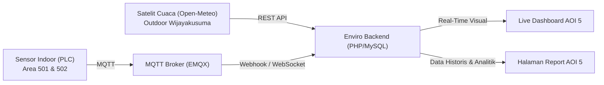
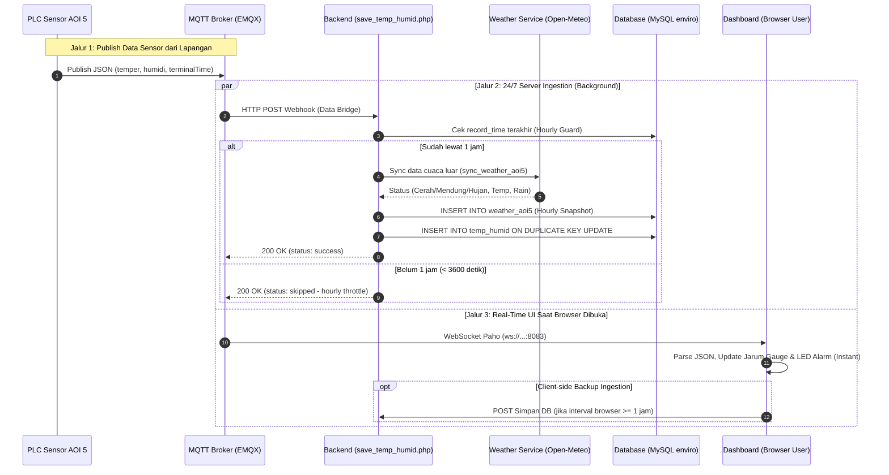
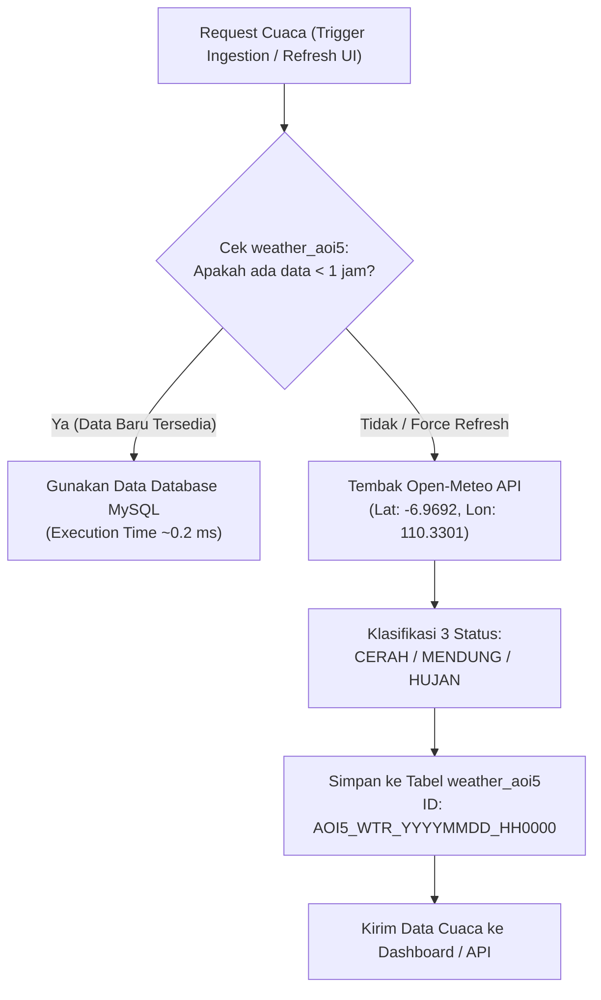

# Panduan Teknis & Cara Kerja Program Monitoring Temperature & Humidity AOI 5

**Sistem:** Enviro Monitoring System  
**Unit Pabrik:** PT Apparel One Indonesia (AOI 5 - Kawasan Industri Wijayakusuma, Semarang)  
**Modul:** Temperature, Humidity & Weather Monitoring  
**Tipe Dokumen:** Dokumentasi Arsitektur & Cara Kerja Program (*Technical Architecture & Workflow*)  

---

## 1. Pendahuluan & Gambaran Umum

Sistem Monitoring **Temperature & Humidity AOI 5** merupakan bagian dari ekosistem portal **Enviro** yang berfungsi untuk memantau, mencatat, dan menganalisis kondisi lingkungan (*micro-climate*) di area manufaktur garmen PT Apparel One Indonesia 5. 

Pada industri garmen (*apparel*), stabilitas suhu dan kelembapan udara sangat krusial untuk:
1. Menjaga kualitas bahan kain (mencegah jamur, perubahan dimensi kain, atau listrik statis).
2. Memastikan kenyamanan dan efisiensi kerja operator produksi.
3. Kepatuhan audit standar buyer internasional mengenai regulasi lingkungan kerja.

Program ini mengintegrasikan sensor PLC industri di dalam ruangan (*indoor*), protokol transmisi MQTT via EMQX Broker, API backend PHP, database MySQL, serta pembanding cuaca luar ruangan (*outdoor weather*) secara otomatis.



---

## 2. Parameter & Spesifikasi Teknis

| Parameter | Spesifikasi | Keterangan Teknis |
| :--- | :--- | :--- |
| **Lokasi Pabrik** | AOI 5 | Kawasan Industri Wijayakusuma, Semarang, Jawa Tengah |
| **Koordinat Pabrik** | `6°58'09.2"S 110°19'48.2"E` | Latitude: `-6.9692`, Longitude: `110.3301` |
| **Area Monitoring** | 2 Titik Sensor Utama | 1. **Sensor 1 (`501` / `area501`)**: Folding Area<br/>2. **Sensor 2 (`502` / `area502`)**: Dry Room |
| **Protokol Sensor** | MQTT via TCP & WebSocket | MQTT Broker EMQX di host server lokal (`192.168.51.40:8083` / `localhost:8083`) |
| **Topik MQTT Sensor 1** | `data/temperature/area501/+` | Contoh: `data/temperature/area501/7122659134180131095` |
| **Topik MQTT Sensor 2** | `data/temperature/area502/+` | Contoh: `data/temperature/area502/7122659134180131095` |
| **Format Payload Sensor** | JSON Object | `{"_terminalTime":"YYYY-MM-DD HH:mm:ss.ms","_groupName":"Area_1","temper":"29.2","humidi":"49.7"}` |
| **Visualisasi Dashboard** | Highcharts Radial Gauge | Pergerakan jarum instan (0 delay, animasi 400ms) & Indikator LED Alarm Berkedip |
| **Integrasi Cuaca Luar** | Open-Meteo Forecast API | Deteksi Suhu Luar, Kelembapan, Curah Hujan, Kecepatan Angin (Status: `CERAH`, `MENDUNG`, `HUJAN`) |
| **Interval Penyimpanan DB** | **1 Jam Sekali (*Hourly Snapshot*)** | Dilindungi *Two-Tier Throttling Guard* (Frontend + Backend) |
| **Format ID Transaksi** | `[id_location]_[YYYYMMDD_HH]0000` | Contoh: `501_20261110_080000` (temp_humid) dan `AOI5_WTR_20261110_080000` (weather_aoi5) |
| **Web Server & Backend** | Apache / Nginx + PHP 7.4 / 8.x | Native PHP, cURL, MySQLi (*Zero Composer Dependency*) |
| **Database Server** | MySQL / MariaDB | Database `enviro`, Tabel: `temp_humid`, `weather_aoi5`, `master_standard` |

---

## 3. Arsitektur Alur Kerja Program (*End-to-End*)

Sistem bekerja melalui **3 jalur transmisi utama** yang beroperasi secara harmonis dan memiliki mekanisme *failover*:



---

## 4. Cara Kerja Rinci Setiap Komponen Sistem

### 4.1. Akuisisi Data Lapangan (PLC Sensor & EMQX Broker)
1. **Sensor Lapangan**: Sensor suhu dan kelembapan terpasang di dua titik penting:
   * **Area 501 (Folding Area)**: Area pelipatan pakaian jadi sebelum proses pengepakan.
   * **Area 502 (Dry Room)**: Ruang pengeringan pakaian dengan persyaratan kelembapan ketat.
2. **Koneksi MQTT**: PLC atau IoT Gateway membaca sinyal sensor analog/digital kemudian mem-publish data ke broker EMQX pada topik `data/temperature/area501/+` dan `data/temperature/area502/+`.
3. **Format Pesan Masuk**:
   ```json
   {
     "_terminalTime": "2026-11-10 08:15:30.120",
     "_groupName": "Area_1",
     "temper": "28.5",
     "humidi": "52.3"
   }
   ```

---

### 4.2. Live Visual Dashboard (`dashboard/temperature/aoi5/index.php`)
Ketika teknisi membuka dashboard di peramban web (*browser*):

1. **Pre-Rendering Server-Side (PHP)**:
   * Halaman secara otomatis membaca nilai data terakhir dari tabel `temp_humid` dan `weather_aoi5`.
   * Gauges langsung menampilkan posisi angka terakhir tanpa jeda layar kosong (*Zero Layout Shift*).
   * Nilai ambang batas (*threshold limits*) dibaca dari tabel `master_standard`.
2. **Koneksi Real-Time WebSocket (JavaScript)**:
   * Menggunakan pustaka `Paho.MQTT.Client` melalui port WebSocket `8083`.
   * Mendengarkan topik `data/temperature/area501/+` dan `data/temperature/area502/+`.
   * Jika koneksi terputus (`onConnectionLost`), timer otomatis mencoba menyambung ulang setiap 5 detik (`reconnectTimeout = 5000`).
3. **Pembaruan Instan Gauge Highcharts**:
   * Begitu payload MQTT tiba di fungsi `onMessageArrived()`, data diekstrak menggunakan parser toleran:
     - Suhu: membaca key `temper`, `temp`, atau `temperature`.
     - Kelembapan: membaca key `humidi`, `humidity`, `hum`, `rh`, atau `kelembapan`.
   * Jarum dial Highcharts langsung bergerak ke nilai baru dalam waktu 400 milidetik secara mulus:
     ```javascript
     chart.series[0].points[0].update(newvalue, true, { duration: 400 });
     ```
4. **Indikator Visual LED Alarm**:
   * Skrip memvalidasi nilai suhu dan kelembapan terhadap standar warna:
     - **Hijau**: Nilai aman / optimal.
     - **Kuning**: Batas peringatan (*warning zone*).
     - **Merah**: Zona bahaya (*danger zone*).
   * Jika nilai masuk ke zona merah, elemen HTML `.led-indicator` diberi kelas `.active`, memicu animasi lampu merah berkedip (*pulsing alert*):
     ```css
     @keyframes pulse-red {
         from { transform: scale(1); opacity: 0.85; }
         to { transform: scale(1.15); opacity: 1; }
     }
     ```

---

### 4.3. Mekanisme Auto-Save & Hourly Throttling Guard

Karena sensor PLC mem-publish data secara kontinu dalam orde detik atau menit, menyimpan seluruh data mentah akan mengakibatkan pembengkakan basis data (*database bloat*). Sistem menerapkan kebijakan **Penyimpanan Snapshot 1 Jam Sekali (Hourly Snapshot)**.

Mekanisme ini dilindungi oleh dua lapis penjaga (*Two-Tier Guard*):

#### Lapis 1: Frontend Client Guard (`localStorage`)
* Dashboard dan halaman menu utama mencatat waktu terakhir pengiriman data per sensor di `localStorage` dengan kunci `enviro_aoi5_last_save_501` dan `enviro_aoi5_last_save_502`.
* Panggilan API `fetch()` ke `api/save_temp_humid.php` hanya dilepas jika selisih waktu sudah mencapai minimal 60 menit ($3.600.000\text{ ms}$).

#### Lapis 2: Backend API Guard (`api/save_temp_humid.php`)
* Backend memeriksa rekaman terakhir di tabel `temp_humid`:
  ```sql
  SELECT record_time FROM temp_humid 
  WHERE id_location = '$id_location' 
  ORDER BY record_time DESC LIMIT 1
  ```
* Jika selisih waktu timestamp payload dengan record terakhir di database $< 3.600\text{ detik}$, request langsung dihentikan (*short-circuit*) dengan status respons:
  ```json
  {
    "status": "skipped",
    "message": "Hourly throttle: Data already saved within the last 1 hour..."
  }
  ```
* **Smart UPSERT SQL**: Jika sudah genap 1 jam, data disimpan dengan klausa `ON DUPLICATE KEY UPDATE` berbasis kondisi `IF`:
  ```sql
  INSERT INTO temp_humid (id_transaction, id_location, temp, humidity, record_time) 
  VALUES ('501_20261110_080000', '501', 28.5, 52.3, '2026-11-10 08:00:00')
  ON DUPLICATE KEY UPDATE 
      temp = IF(28.5 > 0, VALUES(temp), temp), 
      humidity = IF(52.3 > 0, VALUES(humidity), humidity), 
      record_time = VALUES(record_time);
  ```
  *Keuntungan:* Jika salah satu parameter bernilai 0 atau parsial, data metrik yang sudah ada tidak tertimpa nilai rusak.

---

### 4.4. Integrasi Deteksi Cuaca Luar Ruangan (*Outdoor Weather*)

Untuk menganalisis korelasi antara kondisi udara luar dengan suhu/kelembapan dalam ruangan, program dilengkapi modul cuaca berbasis Open-Meteo API yang terhubung secara otomatis:



#### Aturan Klasifikasi Status Cuaca (Standar Pabrik Tanpa Icon)
Sistem menggunakan klasifikasi bertingkat (*hierarchical classification*):
1. **`HUJAN`** (Badge Biru / `.badge-primary`):
   - Jika `rainfall > 0 mm`, atau
   - Kode cuaca WMO berada pada kategori hujan/badai (`51–67`, `80–82`, `95–99`).
2. **`MENDUNG`** (Badge Kuning / `.badge-warning`):
   - Jika kode cuaca WMO berupa kabut/awan tebal (`2, 3, 45, 48`), atau
   - Persentase tutupan awan (*cloud cover*) $\ge 50\%$.
3. **`CERAH`** (Badge Hijau / `.badge-success`):
   - Jika tutupan awan $< 50\%$ dan kode cuaca cerah/sedikit berawan (`0, 1`).

> [!NOTE]
> Modul cuaca beroperasi **100% tanpa file cache JSON** pada disk server. Seluruh validasi riwayat dan cache dibaca langsung dari tabel MySQL `weather_aoi5`, sehingga menjaga performa I/O server tetap bersih dan bebas resiko korupsi file.

---

### 4.5. Halaman Laporan & Analisis Historis (`report/temperature/aoi5/index.php`)

Halaman laporan memungkinkan tim Engineering, QC, dan Manajer Pabrik untuk melihat dan mengunduh rekaman lingkungan:

1. **Relasi Data Antara Suhu Ruangan & Cuaca Luar**:
   Data sensor dihubungkan dengan data cuaca luar pada jam yang sama melalui klausa `LEFT JOIN`:
   ```sql
   SELECT t.id_transaction, t.id_location, t.temp, t.humidity, t.record_time,
          DATE_FORMAT(t.record_time, '%W') AS day_name,
          w.weather_status, w.temp_outdoor
   FROM temp_humid t
   LEFT JOIN weather_aoi5 w 
       ON w.id_transaction = CONCAT('AOI5_WTR_', DATE_FORMAT(t.record_time, '%Y%m%d_%H'), '0000')
   WHERE t.id_location IN ('501', '502', 'area501', 'area502')
     AND DATE(t.record_time) BETWEEN '$safe_range1' AND '$safe_range2'
   ORDER BY t.record_time DESC
   ```
2. **Keamanan Query (Sanitasi SQL)**:
   Input tanggal dari *DateRangePicker* disaring ketat menggunakan `mysqli_real_escape_string` untuk mencegah serangan celah *SQL Injection*.
3. **Fitur Ekspor Excel Format Matriks Horisontal Pabrik & Grafik Native Dinamis (PhpSpreadsheet)**:
   Tombol ekspor Excel dihubungkan ke backend service [`report/temperature/aoi5/export_excel_native.php`](file:///e:/Apparel/Enviro/enviro/report/temperature/aoi5/export_excel_native.php) yang menghasilkan file `.xlsx` dengan format kendali mutu standar pabrik (*QC Micro-Climate Matrix Sheet*):
   * **Multi-Sheet**:
     * **Sheet 1 (`SUHU AREA`)**:
       * **Blok Matriks 1 (`SUHU AREA DRYROOM` - 502)**: Matriks horisontal dengan kolom tanggal dinamis sesuai rentang filter web, kolom `AVG` (`=AVERAGE()`), 10 baris Suhu jam sampling (07:00 – 16:00, nearest match $\pm 45$ menit), 10 baris Kelembapan jam sampling (format persentase `0%`), baris inisial `CUACA` (`C`/`M`/`H`), baris `AVERAGE TEMP` harian (`=AVERAGE()`), dan baris `AERAGE HUMIDITY` harian (`=AVERAGE()`).
       * **Blok Matriks 2 (`SUHU AREA FOLDING` - 501)**: Format matriks identik dengan Blok 1 untuk area folding.
       * **4 Native Line Charts (Opsi A - Di Bawah Matriks)**:
         1. *Grafik Tren Rata-rata Suhu Harian (Dry Room vs Folding vs Batas Aman 30°C)*
         2. *Grafik Tren Rata-rata Kelembapan Harian (Dry Room vs Folding vs Batas Aman 60%)*
         3. *Grafik Profil Fluktuasi Rata-rata Suhu Jam Sampling (07:00 – 16:00)*
         4. *Grafik Profil Fluktuasi Rata-rata Kelembapan Jam Sampling (07:00 – 16:00)*
       * **Koneksi Dinamis**: Grafik terhubung langsung ke formula baris matriks dan kolom tanggal. Jika angka diubah di Excel, grafik langsung bergerak secara dinamis.
     * **Sheet 2 (`Data Detail Historis`)**: Seluruh rekaman historis database (9 kolom bersih: No, Factory, ID Location, Location, Temperature, Humidity, Weather, Record Time, Day Name) dengan format angka desimal dan penandaan sel merah bagi suhu $> 30.0^\circ\text{C}$ atau kelembapan $> 60.0\%$.
     * **Sheet 3 (`Chart Data Source`)**: Lembar kerja rujukan formula dinamis dan garis batas acuan (30°C / 60%).
   * **Batas Acuan Aman Pabrik**:
     * Sumbu Suhu: Garis acuan horizontal pada **30.0 °C**.
     * Sumbu Kelembapan: Garis acuan horizontal pada **60.0 %** (`0.60`).

---

## 5. Struktur Basis Data (Database Schema)

### 5.1. Tabel `temp_humid` (Snapshot Sensor Per Jam)
Menyimpan riwayat suhu dan kelembapan ruangan pabrik.

| Nama Kolom | Tipe Data | Nullable | Keterangan |
| :--- | :--- | :---: | :--- |
| `id_transaction` | `VARCHAR(50)` | NO (PK) | Format: `[id_loc]_[YYYYMMDD_HH]0000` |
| `id_location` | `VARCHAR(20)` | NO | `501` (Folding Area) atau `502` (Dry Room) |
| `temp` | `DOUBLE / FLOAT` | YES | Nilai suhu dalam ruangan (°C) |
| `humidity` | `DOUBLE / FLOAT` | YES | Nilai kelembapan dalam ruangan (%) |
| `record_time` | `DATETIME` | NO | Waktu pencatatan data |

### 5.2. Tabel `weather_aoi5` (Snapshot Cuaca Luar Per Jam)
Menyimpan kondisi cuaca di sekitar area pabrik.

| Nama Kolom | Tipe Data | Nullable | Keterangan |
| :--- | :--- | :---: | :--- |
| `id_transaction` | `VARCHAR(50)` | NO (PK) | Format: `AOI5_WTR_[YYYYMMDD_HH]0000` |
| `factory` | `VARCHAR(20)` | YES | Bernilai default `'AOI 5'` |
| `weather_status` | `ENUM('Cerah','Mendung','Hujan')` | NO | Kategori status cuaca baku |
| `temp_outdoor` | `DECIMAL(4,1)` | YES | Suhu luar ruangan (°C) |
| `humidity_outdoor` | `DECIMAL(4,1)` | YES | Kelembapan luar ruangan (%) |
| `rainfall` | `DECIMAL(5,1)` | YES | Curah hujan (mm) |
| `wind_speed` | `DECIMAL(5,1)` | YES | Kecepatan angin (km/jam) |
| `cloud_cover` | `INT` | YES | Tutupan awan (%) |
| `weather_code` | `INT` | YES | Kode kondisi cuaca standar WMO |
| `record_time` | `DATETIME` | NO | Waktu snapshot cuaca |

### 5.3. Tabel `master_standard` (Ambang Batas Suhu & Kelembapan)
Digunakan sebagai acuan pewarnaan gauge dan alarm LED.

| Parameter Batas | Suhu (°C) | Kelembapan (%) | Indikasi Status |
| :--- | :---: | :---: | :--- |
| **Batas Bawah Merah** | $< 18.0$ | $< 30.0$ | Bahaya Terlalu Rendah / Dingin / Kering |
| **Batas Kuning 1** | $18.0 - 21.0$ | - | Peringatan Rendah |
| **Batas Optimal (Hijau)** | $21.0 - 27.0$ | $30.0 - 55.0$ | **Kondisi Standar / Ideal** |
| **Batas Kuning 2** | $27.0 - 30.0$ | $55.0 - 60.0$ | Peringatan Tinggi |
| **Batas Atas Merah** | $> 30.0$ | $> 60.0$ | **Bahaya Terlalu Panas / Lembap (Alarm LED)** |

---

## 6. Struktur Direktori & Peran File

```text
enviro/
├── api/
│   ├── save_temp_humid.php    # Endpoint REST / Webhook penerima data sensor 24/7 & guard 1 jam
│   ├── weather_helper.php     # Service logika penarikan & klasifikasi cuaca luar AOI 5
│   └── get_weather.php        # REST API penyedia status cuaca ke dashboard browser
├── dashboard/
│   └── temperature/
│       └── aoi5/
│           └── index.php      # Live Dashboard: Highcharts gauge instan, LED alarm, & weather banner
├── report/
│   └── temperature/
│       └── aoi5/
│           ├── index.php               # Halaman riwayat data, filter tanggal, tabel gabungan, & export
│           └── export_excel_native.php # Engine ekspor Excel multi-sheet dengan 4 Grafik Native Dinamis (PhpSpreadsheet)
├── config_temp_humid.php               # Konfigurasi koneksi MySQL database 'enviro'
├── index.php                           # Halaman portal utama sistem Enviro & background client sync
├── migration_weather_aoi5.sql          # Skrip DDL pembentukan tabel database weather_aoi5
└── vendor/                             # Pustaka Composer lokal LTS PHP 7.4 (PhpSpreadsheet 1.30, zipstream 2.2, etc.) siap upload via FileZilla
```

---

## 7. Mekanisme Ketahanan (*Fault-Tolerance & Fallback*)

Untuk memastikan keandalan operasi di lingkungan pabrik manufaktur 24/7:

1. **Dual Ingestion Path (Kemandirian Server)**:
   - **Primer**: EMQX Data Bridge (Webhook) langsung mengirim data sensor ke `api/save_temp_humid.php` di latar belakang server, sehingga pencatatan data ke basis data **tetap berjalan nonstop meskipun tidak ada satupun browser yang membuka dashboard**.
   - **Sekunder**: Jika EMQX Webhook belum dikonfigurasi, JavaScript di dashboard dan `index.php` bertindak sebagai penyinkron cadangan setiap kali halaman dibuka.
2. **Koneksi MQTT Auto-Reconnect**:
   - Skrip dashboard dilengkapi fungsi *heartbeat* `keepAliveInterval: 30` dan *listener* `onConnectionLost`. Apabila broker sempat restart, dashboard otomatis menyambung kembali tanpa perlu refresh browser.
3. **Graceful Fallback Deteksi Cuaca**:
   - Jika koneksi internet pabrik terputus saat mengambil data Open-Meteo, backend menangkap galat secara halus (*graceful exception handling*) dan menyajikan data cuaca terakhir yang tersimpan di MySQL lokal.
4. **Proteksi Duplikasi & Kerusakan Data (Smart UPSERT)**:
   - Primary key berbasis jam menjamin tidak akan terjadi duplikasi baris data pada jam yang sama, dan klausa `IF(val > 0, ...)` melindungi data valid agar tidak tertimpa nilai nol saat ada transmisi parsial.

---

## 8. Panduan Pengujian & Operasional

### 8.1. Menguji Dashboard Secara Lokal
1. Pastikan server PHP lokal aktif di root folder `enviro`:
   ```powershell
   php -S 0.0.0.0:8000
   ```
2. Buka dashboard di browser:
   * **Live Dashboard AOI 5**: `http://localhost:8000/dashboard/temperature/aoi5/`
   * **Report AOI 5**: `http://localhost:8000/report/temperature/aoi5/`
   * **Portal Utama**: `http://localhost:8000/index.php`

### 8.2. Simulasi Pengiriman Data Sensor (Test Ingestion)
Kirim request HTTP POST ke `api/save_temp_humid.php` menggunakan PowerShell / cURL:

```powershell
# Contoh Simulasi Sensor 1 (Area 501 / Folding Area)
Invoke-RestMethod -Uri "http://localhost:8000/api/save_temp_humid.php" -Method Post -ContentType "application/json" -Body '{"_terminalTime":"2026-11-10 08:30:00","_groupName":"Area_1","temper":"29.4","humidi":"51.2"}'
```

**Hasil Respons:**
* **Simulasi Pertama**: Respons `"status": "success"` (data tersimpan di database).
* **Simulasi Kedua dalam selang waktu < 1 jam**: Respons `"status": "skipped"` (dilindungi Hourly Guard).

### 8.3. Simulasi Pengiriman Data MQTT
Kirim payload berikut ke topik EMQX broker:
* **Topik:** `data/temperature/area501/test_device`
* **Payload:**
  ```json
  {"_terminalTime":"2026-11-10 08:30:00","_groupName":"Area_1","temper":"31.5","humidi":"65.0"}
  ```
* **Hasil di Dashboard:** Jarum gauge langsung melonjak ke 31.5°C dan 65.0%, serta lampu indikator LED bulat menyala merah berkedip (*danger alert*).

---

## 9. Kesimpulan

Program Monitoring Temperature & Humidity AOI 5 dirancang dengan memadukan visualisasi responsif seketika (*instant zero-delay*) untuk kebutuhan pemantauan lapangan langsung, dengan sistem pencatatan per jam hemat memori (*hourly snapshot*) untuk kebutuhan audit jangka panjang. Dukungan integrasi cuaca luar ruangan memberikan konteks analitik yang komprehensif bagi tim operasional pabrik PT Apparel One Indonesia.

