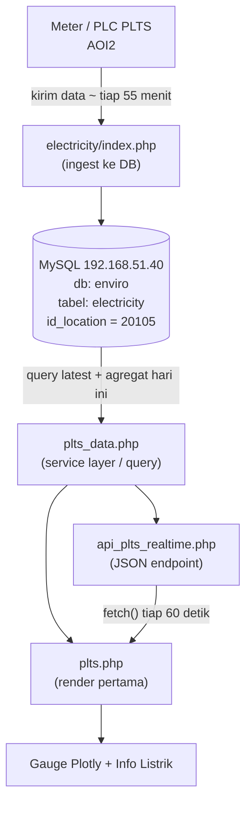

# Planning & Panduan Implementasi — PLTS Dashboard AOI2 (Data Realtime dari Database)

**Project:** Enviro Monitoring System
**Modul:** Energy Dashboard AOI2 → Halaman **PLTS Dashboard -AOI2-**
**File utama yang dikerjakan:** `dashboard/energy/aoi2/plts.php`
**Tanggal dokumen:** 21 Oktober 2026
**Revisi:** 1.3 — 21 Oktober 2026 (section card "Informasi Listrik" direvisi; **Rev 1.3** menambahkan solusi anomali meter → lihat `PLANNING_PLTS_INFORMASI_LISTRIK_AOI2.md`)
**Target implementasi:** Junior Programmer + AI Agent (model murah)
**Status dokumen:** ✅ **SUDAH DIIMPLEMENTASIKAN** (lihat Bab 18)

---

> ## REVISI 1.3 - BACA DULU
>
> Section card **"Informasi Listrik"** pada halaman ini **sudah direvisi** (Rev 1.2).
> **Dokumen revisi: `PLANNING_PLTS_INFORMASI_LISTRIK_AOI2.md`** —BACU dokumen itu lebih dulu.
>
> | Yang berubah | Rev 1.1 (dokumen ini) | **Rev 1.2 (terbaru)** |
> | :--- | :--- | :--- |
> | Baris 1 info box | `Power Factor` → `—` | **`Consumption`** → `SUM(consumpt)` hari ini |
> | Baris 3 info box | `Total KWH` = `SUM(kwh)` hari ini | **`Total KWH` = realtime** (1 data terbaru) |
> | Konstanta | `PLTS_KWH_MODE` | **`PLTS_TOTAL_KWH_MODE`** + **`PLTS_CONSUMPTION_MODE`** (default `sanitized`) |
> | Anomali meter | (tidak dibahas) | **Rev 1.3** - mode `sanitized` membuang baris bermasalah + penanda warning |
> | Key JSON `data` | `power_factor` (null) | **`consumption`** (angka) |
>
> ⚠️ **Kode contoh di dokumen ini yang menyebut `PLTS_KWH_MODE`, `power_factor`, atau `valPowerFactor` sudah usang** — constant/key tersebut **dihapus** di Rev 1.2. Bagian yang **tidak** terpengaruh Rev 1.2 (query, gauge, auto-refresh, status bar, struktur halaman) **tetap berlaku** dan dipakai sebagai referensi.

---

---

## Daftar Isi

| Bab | Isi |
| :--- | :--- |
| [0](#0-ringkasan-singkat-baca-dulu) | Ringkasan singkat parameter |
| [1](#1-ringkasan-eksekutif) | Ringkasan eksekutif & prinsip pelaksanaan |
| [2](#2-target--cakupan-kerja) | Target & cakupan kerja (in scope / out of scope) |
| [3](#3-arsitektur-solusi) | Arsitektur solusi & alur refresh |
| [4](#4-fakta-teknis-terverifikasi-sudah-diuji-langsung-ke-database) | **Fakta terverifikasi ke database** (struktur tabel, sample data, skala gauge) |
| [5](#5-pemetaan-requirement--sumber-data-bagian-ini) | **Pemetaan requirement → sumber data** + keputusan desain (KDP) |
| [6](#6-daftar-file-yang-dikerjakan) | Daftar file yang dikerjakan |
| [7](#7-rencana-implementasi-urutan-kerja) | Rencana implementasi (urutan kerja) |
| [8](#8-kode-lengkap-siap-salin-tempel--copy-paste) | **Kode lengkap** siap copy-paste (2 file baru + 6 patch) |
| [9](#9-verifikasi-langsung-di-database-sql-client) | Verifikasi langsung di SQL client |
| [10](#10-checklist-verifikasi-definition-of-test) | **Checklist verifikasi** + uji error |
| [11](#11-penanganan-edge-case) | Penanganan edge case |
| [12](#12-catatan-teknis-tambahan) | Catatan teknis (index DB, timezone, format angka) |
| [13](#13-panduan-deployment-filezilla) | Panduan deployment |
| [14](#14-definition-of-done-selesai-bila-semua-terpenuhi) | Definition of Done |
| [15](#15-troubleshooting) | Troubleshooting |
| [16](#16-lampiran) | Lampiran (kontrak JSON, aturan golden) |
| [17](#17-riwayat-dokumen) | Riwayat dokumen |
| [18](#18-hasil-implementasi--verifikasi-rev-11) | **Hasil implementasi & verifikasi** (Rev 1.1) |

---

## 0. Ringkasan Singkat (Baca Dulu)

Tugas: **menghapus data dummy (statis) pada halaman `plts.php` dan menggantinya dengan data dinamis (realtime) dari database MySQL.**

| Item | Nilai |
| :--- | :--- |
| Database | `enviro` |
| Host DB | `192.168.51.40:3306` (sudah ada di `config_electricity.php`, **jangan diubah**) |
| Tabel | `electricity` |
| Filter | `id_location = '20105'` (PLTS / RTS AOI2) |
| Polarity data | Voltage & Current = **realtime** (baris terakhir) · Power & Total KWH = **agregat hari ini** (00:00 → jam terbaru) |
| Refresh | AJAX otomatis setiap **60 detik** (tanpa reload halaman) |
| Tampilan akhir | **2 section card**: ① Tegangan 1 Phasa ② Arus R,S,T (Ampere) & Informasi Listrik |
| Section card 3 Phasa | **DIHAPUS** (Rev 1.1) — beserta 3 gauge Voltage RS/ST/RT & divider vertikal |
| File baru | 2 file (service layer + endpoint JSON) |
| File diubah | 1 file (`plts.php`) |

---

## 1. Ringkasan Eksekutif

Halaman **PLTS Dashboard -AOI2-** (`dashboard/energy/aoi2/plts.php`) saat ini masih menampilkan **data dummy hard-coded** di dalam file PHP (baris 12–25). Nilai-nilai tersebut tidak pernah berubah dan tidak berasal dari sistem.

Target akhir: halaman tersebut membaca data **langsung dari tabel `electricity`** (database `enviro`, `id_location = 20105`) sehingga:

1. Gauge **Voltage R/S/T** dan **Current R/S/T** selalu menampilkan **nilai terbaru** yang masuk dari alat (meter) di lapangan.
2. **Section card "3 Phasa (Antar Fasa)" dihapus seluruhnya** (beserta 3 gauge Voltage RS/ST/RT dan divider vertikal), karena kolom `voltage_rs/st/rt` **tidak tersedia** di sumber data. Tampilan akhir hanya **2 section card**.
3. Kotak **Informasi Listrik** menampilkan:
   - **Power Output** = `SUM(power)` untuk hari berjalan (00:00 → data terakhir hari ini).
   - **Power Factor** = **nihil / tidak diisi** (kolom `power_factor` memang selalu `NULL` untuk lokasi 20105).
   - **Total KWH** = `SUM(kwh)` untuk hari berjalan (00:00 → data terakhir hari ini).
4. Data **auto-refresh** tiap 60 detik lewat AJAX (tidak reload halaman), dilengkapi indikator status koneksi DB dan label "Terakhir update".

### 1.1 Prinsip Pelaksanaan (WAJIB DIPATUHI)

> **Hanya ubah 3 file yang disebutkan pada Bab 5. Jangan menyentuh file lain. Jangan mengubah `config_electricity.php`. Jangan membuat data dummy baru di mana pun.**

---

## 2. Target & Cakupan Kerja

### 2.1 IN SCOPE (harus dikerjakan)

1. Menghapus seluruh blok data dummy dari `plts.php`.
2. Mengambil data realtime dari tabel `electricity` (`id_location = 20105`).
3. Mapping 9 field UI ke kolom DB (lihat Bab 5).
4. **Menghapus seluruh section card "3 Phasa (Antar Fasa)"** (container, judul grup, 3 gauge Voltage RS/ST/RT, dan divider vertikal `.v-divider`) sehingga tersisa **2 section card**.
5. Mengosongkan Power Factor dengan tampilan `—` (bukan `0`).
6. Menghitung Power Output & Total KWH sebagai agregat hari ini (00:00 → data terbaru).
7. Auto-refresh AJAX 60 detik + status koneksi + label "Terakhir update".
8. Menampilkan badge "Realtime" (menggantikan badge "Data Dummy Sementara").
9. Penanganan error koneksi DB (bukan blank page / fatal error).

### 2.2 OUT OF SCOPE (DILARANG dikerjakan)

* ❌ Mengubah tampilan/layout/CSS secara visual (hanya boleh **menambah** CSS baru untuk status bar & empty state).
* ❌ Mengubah `dashboard/energy/aoi2/index.php` (Energy Dashboard) — halaman ini sudah punya sumber data sendiri (`realtime_power`).
* ❌ Mengubah `config_electricity.php`, `config_electricity_aoi1.php`, `config_temp_humid.php`.
* ❌ Mengubah tabel `electricity` atau menambah kolom baru.
* ❌ Menambah library/plugin baru. **Plotly.js sudah tersedia lokal** di `dashboard/energy/aoi2/js/plotly-2.30.0.min.js` (dilarang pakai CDN).
* ❌ Membuat tabel baru / membuat endpoint baru selain yang ada di Bab 5.
* ❌ Mengubah query di halaman lain.

---

## 3. Arsitektur Solusi

### 3.1 Diagram Alur Data



### 3.2 Alur Refresh

1. Browser membuka `plts.php` → PHP melakukan query → data **render pertama** (tidak ada layar kosong).
2. Setelah halaman selesai dimuat, JavaScript menjalankan `fetch()` ke `api_plts_realtime.php` **setiap 60 detik**.
3. Endpoint mengembalikan JSON terbaru → JavaScript memperbarui gauge (Plotly), angka Power Output / Total KWH, dan label "Terakhir update" **tanpa reload halaman**.
4. Tombol **⟳ Refresh** tersedia untuk refresh manual.
5. Bila endpoint gagal (DB down / timeout), halaman **tidak blank**: gauge mempertahankan nilai terakhir, status bar berubah menjadi merah + pesan error.

---

## 4. Fakta Teknis Terverifikasi (Sudah Diuji Langsung ke Database)

Bagian ini adalah **hasil query langsung** ke server `192.168.51.40` pada **21 Oktober 2026 ~10:57 WIB**. Gunakan data ini untuk pembanding saat pengujian.

### 4.1 Struktur Tabel `electricity` (hasil `SHOW COLUMNS FROM electricity`)

| # | Nama Kolom | Tipe | Keterangan |
| :-- | :--- | :--- | :--- |
| 1 | `id_transaction` | `varchar(255)` | PRIMARY KEY, format `20105_20261021_105717` |
| 2 | `id_location` | `varchar(100)` | `20105` = PLTS AOI2 |
| 3 | `current_r` | `decimal(10,2)` | Arus fasa R (A) |
| 4 | `current_s` | `decimal(10,2)` | Arus fasa S (A) |
| 5 | `current_t` | `decimal(10,2)` | Arus fasa T (A) |
| 6 | `voltage_r` | `decimal(10,2)` | Tegangan fasa R (V) |
| 7 | `voltage_s` | `decimal(10,2)` | Tegangan fasa S (V) |
| 8 | `voltage_t` | `decimal(10,2)` | Tegangan fasa T (V) |
| 9 | `current_average` | `decimal(10,2)` | Rata-rata arus (tidak dipakai di halaman ini) |
| 10 | `voltage_average` | `decimal(10,2)` | Rata-rata tegangan (tidak dipakai di halaman ini) |
| 11 | `power` | `decimal(10,2)` | Daya sesaat (kW) — **dijumlahkan per hari** |
| 12 | `power_factor` | `decimal(10,2)` | **Selalu `NULL` untuk 20105** (28.652 dari 28.652 baris) |
| 13 | `kwh` | `decimal(10,2)` | **Akumulasi meter kWh** (kumulatif, bukan per-jam) |
| 14 | `consumpt` | `decimal(10,2)` | Selisih kWh sejak record sebelumnya |
| 15 | `datenow` | `datetime` | Waktu pencatatan, **menggunakan zona waktu Asia/Jakarta (WIB)** |

> **PENTING — tidak ada kolom `voltage_rs`, `voltage_st`, `voltage_rt`, dan tidak ada kolom `kwh_total`.**
> Ini adalah alasan teknis mengapa 3 gauge 3-Phasa **harus dikosongkan** (bukan salah konfigurasi).

### 4.2 Contoh 5 Baris Terakhir (id_location = 20105, 21 Oktober 2026)

| datenow (WIB) | voltage_r | voltage_s | voltage_t | current_r | current_s | current_t | power | kwh | consumpt |
| :--- | ---: | ---: | ---: | ---: | ---: | ---: | ---: | ---: | ---: |
| 2026-10-21 10:57:17 | 231.93 | 229.45 | 231.55 | 260.00 | 261.18 | 258.87 | 179.58 | 1400373.00 | 197.00 |
| 2026-10-21 10:02:17 | 232.02 | 230.49 | 233.89 | 239.00 | 239.53 | 241.07 | 166.73 | 1400176.00 | 131.00 |
| 2026-10-21 09:07:17 | 233.73 | 231.24 | 234.63 | 215.00 | 213.07 | 214.24 | 149.45 | 1400045.00 | 131.00 |
| 2026-10-21 08:12:18 | 232.20 | 230.60 | 233.81 | 167.00 | 167.35 | 166.21 | 116.48 | 1399914.00 | 66.00 |
| 2026-10-21 07:17:19 | 232.79 | 230.16 | 232.69 | 110.50 | 110.96 | 111.45 | 77.47 | 1399848.00 | 65.00 |

### 4.3 Agregat "Hari Ini" (21 Oktober 2026, per 21 Okt ~10:57 WIB)

| Nilai | Amount |
| :--- | ---: |
| Jumlah record hari ini | 12 |
| `SUM(power)` | **722.86** |
| `SUM(kwh)` | **16,798,837.00** |
| `SUM(consumpt)` | 590.00 |
| `MAX(kwh)` | 1,400,373.00 |
| Record terakhir | 2026-10-21 10:57:17 |

### 4.4 Facts & Batas Nilai (untuk menentukan skala gauge)

| Metrik | Min (30 hari) | Max (30 hari) | Rekomendasi skala gauge |
| :--- | ---: | ---: | :--- |
| `voltage_r/s/t` | 0.00 | 242.81 | **0 – 250 V** (sesuai dummy lama, aman) |
| `current_r/s/t` | 0.00 | **282.00** | **0 – 300 A** ⚠️ dummy lama hanya 200 A → **jarum akan PENUH/overflow**, wajib diubah ke 300 |
| `power` | -0.07 | 200.29 | tampil di info box (bukan gauge) |
| `kwh` | 0.00 | 1,400,373.00 | tampil di info box |

> ⚠️ **Temuan penting:** data Arus (Current) untuk PLTS mencapai **282 A**, sedangkan gauge dummy lama memakai `maxVal = 200`. Jika tidak diubah, jarum gauge akan mentok di kanan atas dan angkanya tidak terbaca. **Wajib ubah max gauge Current menjadi 300.**

### 4.5 Karakteristik Data (wajib diketahui sebelum coding)

| Fakta | Impact ke Coding |
| :--- | :--- |
| Interval tulis ke DB ≈ **55 menit** (bukan per detik) | Polling 60 detik cukup; label "Terakhir update" wajib ada agar user tahu kapan data terakhir masuk |
| Jam server DB = **WIB**, kolom `datenow` juga WIB | Pakai `CURDATE()` di SQL (otomatis ikut WIB). **Jangan** hitung tanggal di PHP dengan timezone default server |
| `power` bisa **negatif** (malam: -0.05) | Jangan di-clamp/ABS-kan di halaman ini (halaman AOI2 Energy boleh, halaman ini tidak diminta) |
| Ada 1 baris anomali `kwh = 0` (16 Okt 2026) | `SUM(kwh)` hari itu tidak akurat — lihat Catatan 5.1 |
| Total baris tabel | ± 154.000 baris → query `WHERE id_location` = **full table scan** (lihat Catatan 5.5) |
| `power_factor` NULL 100% | Selalu tampilkan `—`, jangan `0` |

---

## 5. Pemetaan Requirement → Sumber Data (BAGIAN INTI)

### 5.1 Tabel Mapping (WAJIB DIPATUHI 1:1)

| # | Field di UI | Kolom DB | Jenis Pengambilan | SQL | Nilai contoh (21 Okt 10:57) | Status |
| :-- | :--- | :--- | :--- | :--- | :---: | :--- |
| 1 | Voltage R (V) | `voltage_r` | Realtime (baris terakhir) | `SELECT ... ORDER BY datenow DESC LIMIT 1` | 231.93 | ✅ |
| 2 | Voltage S (V) | `voltage_s` | Realtime | idem | 229.45 | ✅ |
| 3 | Voltage T (V) | `voltage_t` | Realtime | idem | 231.55 | ✅ |
| 4 | Voltage RS (V) | *(tidak ada)* | **Container dihapus** | — | — | ⛔ tidak ditampilkan |
| 5 | Voltage ST (V) | *(tidak ada)* | **Container dihapus** | — | — | ⛔ tidak ditampilkan |
| 6 | Voltage RT (V) | *(tidak ada)* | **Container dihapus** | — | — | ⛔ tidak ditampilkan |
| 7 | Current R (A) | `current_r` | Realtime | idem | 260.00 | ✅ |
| 8 | Current S (A) | `current_s` | Realtime | idem | 261.18 | ✅ |
| 9 | Current T (A) | `current_t` | Realtime | idem | 258.87 | ✅ |
| 10 | Power Output | `power` | **SUM hari ini** (00:00 → data terakhir) | `SUM(power) WHERE CAST(datenow AS DATE) = CURDATE()` | 722.86 | ✅ |
| 11 | Power Factor | `power_factor` | **NIHIL — tidak diisi** | *(tidak diambil; kolom NULL 100%)* | — | ⛔ kosong |
| 12 | Total KWH | `kwh` | **SUM hari ini** (00:00 → data terakhir) | `SUM(kwh) WHERE CAST(datenow AS DATE) = CURDATE()` | 16.798.837,00 | ✅ |

### 5.2 Tiga Query yang Dipakai (JANGAN BERUBAH tanpa persetujuan)

**Query 1 — Data realtime terakhir (6 field gauge):**

```sql
SELECT voltage_r, voltage_s, voltage_t,
       current_r, current_s, current_t,
       power, kwh, datenow
FROM electricity
WHERE id_location = '20105'
ORDER BY datenow DESC
LIMIT 1;
```

**Query 2 — Agregat hari ini (Power Output & Total KWH):**

```sql
SELECT COUNT(*)        AS jml_record,
       SUM(power)      AS sum_power,
       SUM(kwh)        AS sum_kwh,
       SUM(consumpt)   AS sum_consumpt,
       MAX(kwh)        AS max_kwh,
       MAX(datenow)    AS last_update
FROM electricity
WHERE id_location = '20105'
  AND CAST(datenow AS DATE) = CURDATE();
```

**Query 3 (opsional, untuk cross-check di SQL client):** lihat Bab 9.

### 5.3 Keputusan Desain Penting (KDP) — Baca & Pahami Dulu

#### KDP-01 → "Total KWH" **REALTIME** (diperbarui di **Rev 1.2** — lihat `PLANNING_PLTS_INFORMASI_LISTRIK_AOI2.md`)

Kolom `kwh` bersifat **kumulatif meter** (pagi 1,399.783 → siang 1.400.832). Karena itu `SUM(kwh)` per hari menghasilkan **21.000.873 kWh**, yaitu angka yang **tidak bermakna secara fisika** (bukan energi harian).

> **Rev 1.1 (usang):** default = `SUM(kwh)` sesuai permintaan awal.
> **Rev 1.2 (berlaku):** default = **1 data terbaru (realtime)** → `1.400.832,00` = akumulasi meter, **sama persis dengan sumber data gauge chart**.

| Nilai `PLTS_TOTAL_KWH_MODE` | Angka hari ini | Makna | Status |
| :--- | ---: | :--- | :--- |
| `last_row` | 1.400.832,00 | **Realtime** — 1 data terbaru (akumulasi meter) | ✅ DEFAULT (Rev 1.2) |
| `sum_kwh` | 21.000.873,00 | `SUM(kwh)` hari ini (angka tidak bermakna) | Alternatif (mode lama) |

**Konstanta diubah di 1 tempat saja:** `dashboard/energy/aoi2/plts_data.php` baris `define('PLTS_TOTAL_KWH_MODE', 'last_row');`
→ **Jika user nanti mengonfirmasi mode lain, cukup ganti 1 baris, tidak ada kode lain yang perlu disentuh.**

> **Catatan Rev 1.2:** konstanta **`PLTS_KWH_MODE` sudah DIHAPUS** (digantikan `PLTS_TOTAL_KWH_MODE` + `PLTS_CONSUMPTION_MODE`).
>
> **Catatan Rev 1.3:** mode `PLTS_CONSUMPTION_MODE` default = `'sanitized'` - `Consumption` dihitung dari selisih meter pada baris **valid** (anomali meter reset / gangguan komunikasi dibuang). Lihat `PLANNING_PLTS_INFORMASI_LISTRIK_AOI2.md` Bab 3.4.

#### KDP-02 → Satuan "Power Output"

Kolom `power` pada kode base ini diperlakukan sebagai **kW** (lihat `standard_power` untuk 20105: `max_green=600, max_yellow=700, max_red=800`, dan `chart_rts` berlabel "Kw"). Dummy lama menuliskan label "W" (nilai 54.250) yang **tidak konsisten** dengan data DB (179.58).

> **Implementasi memakai label `kW`** (default) melalui konstanta `PLTS_POWER_UNIT` di `plts_data.php`.
> **Nilai** yang ditampilkan tetap persis `SUM(power)` sesuai permintaan. Hanya **label satuan** yang disesuaikan ke `kW`.
> Jika user ingin kembali ke "W", ubah 1 baris: `define('PLTS_POWER_UNIT', 'W');`

#### KDP-03 → Skala Gauge

| Gauge | Max lama (dummy) | Max baru | Alasan |
| :--- | ---: | ---: | :--- |
| Voltage R/S/T | 250 | **250** (tetap) | data max 242.81 ✓ |
| Voltage RS/ST/RT | 450 | **— (kosong)** | tidak ada data |
| Current R/S/T | 200 | **300** ⚠️ | data max 282 A → 200 akan overflow |

#### KDP-04 → Section card "3 Phasa (Antar Fasa)" **DIHAPUS** (Rev 1.1)

Gauge 3-Phasa **tidak dirender sama sekali** — bukan gauge bernilai `0` (akan menyesatkan: terlihat seperti tegangan 0 V), bukan juga *empty state*.

> **Keputusan (Rev 1.1):** container `3 Phasa (Antar Fasa)` beserta **3 gauge Voltage RS/ST/RT** dan **divider vertikal (`.v-divider`)** dihapus dari halaman.
> Konsekuensi:
> * Section card pertama menjadi **1 kolom penuh** → CSS tambahan `.tegangan-container { grid-template-columns: 1fr; }` (override aturan lama `1fr 2px 1fr`).
> * `GAUGE_CONFIG` hanya berisi **6 gauge** (`gaugeR/S/T`, `gaugeIR/IS/IT`).
> * `resizeAllPlotly()` hanya me-resize **6 gauge** tersebut.
> * **Kontrak API tidak berubah** — `voltage_rs/st/rt` tetap dikirim sebagai `null` (dibutuhkan bila suatu saat section ini ditambahkan kembali).

#### KDP-05 → Power Factor **DIHAPUS** (Rev 1.2) — diganti "Consumption"

`number_format(null, 3)` menghasilkan `"0"` → user akan mengira data ada bernilai 0. Karena kolom `power_factor` **selalu NULL** untuk lokasi 20105, baris tersebut kini **diganti** menjadi **"Consumption"** (kWh) dengan sumber `SUM(consumpt)` hari ini.

> **Rev 1.2:** baris info box ke-1 menjadi `Consumption`; key JSON `power_factor` dihapus, digantikan `data.consumption`. Lihat `PLANNING_PLTS_INFORMASI_LISTRIK_AOI2.md`.

#### KDP-06 → Refresh 60 detik via AJAX, bukan reload halaman

Reload penuh tiap menit akan membuang resource dan membuat gauge berkedip. Dipakai `fetch()` + `Plotly.react()` (bukan `newPlot()`) supaya animasi halus.

#### KDP-07 → Format angka

Server (PHP) dan Browser (JS) **wajib memakai format yang sama**: pemisah ribuan `,` dan desimal `.` (default `number_format()` PHP). **Jangan** pakai `toLocaleString('id-ID')` di JS karena hasilnya `54.250,00` → angka akan "lompat" format saat refresh pertama.

---

## 6. Daftar File yang Dikerjakan

| File | Tipe | Lokasi | Deskripsi |
| :--- | :--- | :--- | :--- |
| `plts_data.php` | 🆕 **BARU** | `dashboard/energy/aoi2/plts_data.php` | Service layer: konfigurasi, koneksi, query, shaping payload JSON. Dibagikan oleh `plts.php` dan endpoint API. |
| `api_plts_realtime.php` | 🆕 **BARU** | `dashboard/energy/aoi2/api_plts_realtime.php` | Endpoint AJAX: mengembalikan JSON berisi data realtime + agregat hari ini. |
| `plts.php` | ✏️ **UBAH** | `dashboard/energy/aoi2/plts.php` | Hapus dummy, pakai service layer, tambah auto-refresh + status bar + empty state 3-Phasa. |
| `config_electricity.php` | ⛔ **JANGAN** | `enviro/config_electricity.php` | Sudah menyediakan `$mysqli`. Tidak boleh diubah. |

> File `sidebar.php` dan `js/plotly-2.30.0.min.js` **tidak berubah**.

---

## 7. Rencana Implementasi (Urutan Kerja)

> **Kerjakan berurutan. Selesai satu file → uji file tersebut sebelum lanjut.**

| Step |_File_ | Kegiatan | Output / Verifikasi |
| :-- | :--- | :--- | :--- |
| **1** | `plts_data.php` | Buat file baru, salin **persis** kode Bab 8.1 | File ada, `php -l` (syntax check) tidak error |
| **2** | `api_plts_realtime.php` | Buat file baru, salin **persis** kode Bab 8.2 | Buka di browser → muncul JSON, bukan halaman error |
| **3** | `plts.php` | Apply 5 patch sesuai Bab 8.3 (PHP header → badge → body → JS → CSS) | Halaman tampil, gauge berisi angka dari DB |
| **4** | — | Uji per Bab 10 (Checklist Verifikasi) | Semua checklist ✅ |
| **5** | — | Deploy ke server via FileZilla (Bab 13) | URL live menyaji data DB |

**Timestaka Fusion per File ( agar tidak lupa):**

```
plts_data.php        →  CREATE + paste kode
api_plts_realtime.php→  CREATE + paste kode
plts.php             →  PATCH 1: blok PHP atas (ganti dummy)
                        PATCH 2: badge header
                        PATCH 3: blok badge + status bar (taruh setelah </table>)
                        PATCH 4: blok gauge card + info box
                        PATCH 5: blok <script> JS
                        PATCH 6: CSS tambahan (taruh sebelum </style>)
```

---

## 8. Kode Lengkap (Siap Salin-Tempel / Copy-Paste)

> **ATURAN:** Kode di bawah adalah acuan final. Jangan menulis ulang dengan gaya sendiri.
> Jika ada yang tidak dimengerti, **tanyakan** — jangan menebak.

### 8.1 FILE BARU — `dashboard/energy/aoi2/plts_data.php`

```php
<?php
/**
 * plts_data.php
 * ---------------------------------------------------------------------------
 * Service layer (data access) untuk "PLTS Dashboard -AOI2-".
 *
 * Sumber data : MySQL database `enviro` -> tabel `electricity`
 *               filter id_location = '20105' (PLTS / RTS AOI2)
 *
 * Dipakai oleh:
 *   1. dashboard/energy/aoi2/plts.php               (render pertama)
 *   2. dashboard/energy/aoi2/api_plts_realtime.php  (refresh AJAX 60 detik)
 *
 * ATURAN:
 *   - File ini TIDAK boleh berisi data dummy.
 *   - Semua query WAJIB memfilter id_location (gunakan PLTS_ID_LOCATION).
 *   - Jangan mengubah isi config_electricity.php.
 * ---------------------------------------------------------------------------
 */

if (!defined('PLTS_DATA_LOADED')) {
    define('PLTS_DATA_LOADED', true);

    // Zona waktu: kolom `datenow` di database menggunakan WIB (Asia/Jakarta).
    date_default_timezone_set('Asia/Jakarta');

    /* ===================================================================
     * KONFIGURASI (ubah HANYA di blok ini)
     * =================================================================== */

    // id_location PLTS di tabel `electricity`
    define('PLTS_ID_LOCATION', '20105');

    // Satuan label "Power Output" pada kotak Informasi Listrik.
    //   'kW' = kilowatt (sesuai pemakaian di Energy Dashboard AOI2 & standard_power)
    //   'W'  = watt
    define('PLTS_POWER_UNIT', 'kW');

    // Satuan label "Consumption" pada kotak Informasi Listrik.
    // Kolom `consumpt` adalah selisih kWh meter -> satuannya kWh.
    define('PLTS_CONSUMPTION_UNIT', 'kWh');

    // Mode "Total KWH": 'last_row' = 1 data terbaru (realtime) | 'sum_kwh' = SUM(kwh) hari ini
    define('PLTS_TOTAL_KWH_MODE', 'last_row');

    // Mode "Consumption": 'sum_consumpt' = SUM(consumpt) hari ini | 'kwh_delta' = MAX(kwh)-MIN(kwh)
    define('PLTS_CONSUMPTION_MODE', 'sum_consumpt');

    /* ===================================================================
     * KONEKSI DATABASE
     * =================================================================== */
    try {
        require_once __DIR__ . '/../../../config_electricity.php';
    } catch (Throwable $e) {
        // PHP 8.1+ melempar exception saat koneksi gagal.
        $GLOBALS['PLTS_DB_ERROR'] = 'Koneksi database gagal: ' . $e->getMessage();
    }
}

/**
 * Cek apakah koneksi database tersedia.
 * @return bool
 */
function plts_db_is_connected($mysqli = null)
{
    if ($mysqli === null) {
        $mysqli = isset($GLOBALS['mysqli']) ? $GLOBALS['mysqli'] : null;
    }
    if (!($mysqli instanceof mysqli)) {
        return false;
    }
    return mysqli_connect_errno() === 0;
}

/**
 * Ubah nilai DB menjadi float, atau null bila kosong / bukan angka.
 * Penting: kolom decimal yang NULL harus tetap null (bukan 0),
 * agar UI bisa menampilkan "—" dan tidak menampilkan angka palsu.
 * @param mixed $value
 * @return float|null
 */
function plts_num_or_null($value)
{
    if ($value === null || $value === '') {
        return null;
    }
    if (!is_numeric($value)) {
        return null;
    }
    return (float) $value;
}

/**
 * Format angka untuk tampilan (pemisah ribuan ",", desimal ".").
 * Mengembalikan "-" bila nilai null / bukan angka.
 * @param mixed $value
 * @param int   $decimals
 * @return string
 */
function plts_fmt_num($value, $decimals = 2)
{
    if (!is_numeric($value)) {
        return '-';
    }
    return number_format((float) $value, $decimals);
}

/**
 * Ambil 1 baris data realtime terakhir untuk id_location PLTS.
 * @param mysqli $mysqli
 * @return array|null
 */
function plts_get_latest_row($mysqli)
{
    $id = mysqli_real_escape_string($mysqli, PLTS_ID_LOCATION);

    $sql = "SELECT voltage_r, voltage_s, voltage_t,
                   current_r, current_s, current_t,
                   power, kwh, datenow
            FROM electricity
            WHERE id_location = '$id'
            ORDER BY datenow DESC
            LIMIT 1";

    $result = mysqli_query($mysqli, $sql);
    if ($result === false) {
        return null;
    }
    $row = mysqli_fetch_assoc($result);
    mysqli_free_result($result);

    return $row ? $row : null;
}

/**
 * Ambil agregat data hari ini (00:00 -> data terakhir hari ini).
 * @param mysqli $mysqli
 * @return array|null
 */
function plts_get_today_aggregate($mysqli)
{
    $id = mysqli_real_escape_string($mysqli, PLTS_ID_LOCATION);

    $sql = "SELECT COUNT(*)        AS jml_record,
                   SUM(power)      AS sum_power,
                   SUM(kwh)        AS sum_kwh,
                   SUM(consumpt)   AS sum_consumpt,
                   MAX(kwh)        AS max_kwh,
                   MAX(datenow)    AS last_update
            FROM electricity
            WHERE id_location = '$id'
              AND CAST(datenow AS DATE) = CURDATE()";

    $result = mysqli_query($mysqli, $sql);
    if ($result === false) {
        return null;
    }
    $row = mysqli_fetch_assoc($result);
    mysqli_free_result($result);

    return $row ? $row : null;
}

/**
 * Susun payload lengkap untuk ditampilkan oleh halaman & endpoint JSON.
 * @param mysqli $mysqli
 * @return array
 */
function plts_build_payload($mysqli)
{
    $latest = plts_get_latest_row($mysqli);
    $agg    = plts_get_today_aggregate($mysqli);

    $sumPower    = $agg ? (float)($agg['sum_power']    ?? 0) : 0.0;
    $sumKwh      = $agg ? (float)($agg['sum_kwh']      ?? 0) : 0.0;
    $sumConsumpt = $agg ? (float)($agg['sum_consumpt'] ?? 0) : 0.0;
    $maxKwh      = $agg ? (float)($agg['max_kwh']      ?? 0) : 0.0;
    $minKwh      = $agg ? (float)($agg['min_kwh']      ?? 0) : 0.0;
    $jmlRecord   = $agg ? (int)($agg['jml_record']     ?? 0) : 0;

    // Total KWH -> mengikuti PLTS_TOTAL_KWH_MODE (lihat KDP-01)
    switch (PLTS_TOTAL_KWH_MODE) {
        case 'sum_kwh':
            $kwhTotal = $sumKwh;
            break;
        case 'last_row':
        default:
            $kwhTotal = plts_num_or_null($latest['kwh'] ?? null);
            if ($kwhTotal === null) {
                $kwhTotal = 0.0;
            }
            break;
    }

    // Consumption -> SUM(consumpt) hari ini (Rev 1.2)
    switch (PLTS_CONSUMPTION_MODE) {
        case 'kwh_delta':
            $consumption = $maxKwh - $minKwh;
            if ($consumption < 0) {
                $consumption = 0.0;
            }
            break;
        case 'sum_consumpt':
        default:
            $consumption = $sumConsumpt;
            break;
    }

    $lastUpdate = $latest['datenow'] ?? ($agg['last_update'] ?? null);

    $data = array(
        // --- Tegangan 1 Phasa (REALTIME: baris terakhir) ---
        'voltage_r' => plts_num_or_null($latest['voltage_r'] ?? null),
        'voltage_s' => plts_num_or_null($latest['voltage_s'] ?? null),
        'voltage_t' => plts_num_or_null($latest['voltage_t'] ?? null),

        // --- Tegangan 3 Phasa: TIDAK ADA di tabel `electricity` -> selalu null ---
        'voltage_rs' => null,
        'voltage_st' => null,
        'voltage_rt' => null,

        // --- Arus R/S/T (REALTIME: baris terakhir) ---
        'current_r' => plts_num_or_null($latest['current_r'] ?? null),
        'current_s' => plts_num_or_null($latest['current_s'] ?? null),
        'current_t' => plts_num_or_null($latest['current_t'] ?? null),

        // --- Informasi Listrik ---
        'consumption'  => $consumption, // Rev 1.2: SUM(consumpt) hari ini (kWh)
        'power'        => $sumPower, // SUM(power) hari ini
        'kwh_total'    => $kwhTotal,  // realtime: kWh baris terakhir (akumulasi meter)
    );

    $meta = array(
        'id_location'         => PLTS_ID_LOCATION,
        'jml_record_hari_ini' => $jmlRecord,
        'sum_power'           => $sumPower,
        'sum_kwh'             => $sumKwh,
        'sum_consumpt'        => $sumConsumpt,
        'max_kwh'             => $maxKwh,
        'min_kwh'             => $minKwh,
        'kwh_latest'          => plts_num_or_null($latest['kwh'] ?? null),
        'kwh_delta_hari_ini'  => $maxKwh - $minKwh,
        'consumption'         => $consumption,
        'consumpt_mode'       => PLTS_CONSUMPTION_MODE,
        'total_kwh_mode'      => PLTS_TOTAL_KWH_MODE,
        'consumpt_unit'       => PLTS_CONSUMPTION_UNIT,
        'power_unit'          => PLTS_POWER_UNIT,
        'last_update_db'      => $lastUpdate,
        'last_update_display' => $lastUpdate
                                 ? date('d-m-Y H:i:s', strtotime($lastUpdate)) . ' WIB'
                                 : '-',
        'server_time'         => date('d-m-Y H:i:s'),
    );

    return array(
        'success' => true,
        'data'    => $data,
        'meta'    => $meta,
    );
}
```

### 8.2 FILE BARU — `dashboard/energy/aoi2/api_plts_realtime.php`

```php
<?php
/**
 * api_plts_realtime.php
 * ---------------------------------------------------------------------------
 * Endpoint JSON untuk auto-refresh "PLTS Dashboard -AOI2-".
 * Dipanggil oleh plts.php setiap 60 detik via fetch().
 *
 * Contoh akses:
 *   http://localhost/enviro/dashboard/energy/aoi2/api_plts_realtime.php
 *
 * Response (contoh):
 * {
 *   "success": true,
 *   "data": { "voltage_r": 231.93, ..., "power": 722.86, "kwh_total": 16798837 },
 *   "meta": { "last_update_display": "21-10-2026 10:57:17 WIB", ... }
 * }
 * ---------------------------------------------------------------------------
 */

header('Content-Type: application/json; charset=utf-8');
header('Cache-Control: no-store, no-cache, must-revalidate, max-age=0');
header('Pragma: no-cache');

require_once __DIR__ . '/plts_data.php';

if (!plts_db_is_connected($mysqli)) {
    http_response_code(503);
    echo json_encode(array(
        'success' => false,
        'message' => isset($GLOBALS['PLTS_DB_ERROR'])
                     ? $GLOBALS['PLTS_DB_ERROR']
                     : 'Koneksi database tidak tersedia.',
    ));
    exit;
}

try {
    $payload = plts_build_payload($mysqli);

    echo json_encode(
        $payload,
        JSON_UNESCAPED_UNICODE | JSON_UNESCAPED_SLASHES | JSON_INVALID_UTF8_SUBSTITUTE
    );
} catch (Throwable $e) {
    http_response_code(500);
    echo json_encode(array(
        'success' => false,
        'message' => 'Gagal membaca data: ' . $e->getMessage(),
    ));
}
```

### 8.3 FILE UBAH — `dashboard/energy/aoi2/plts.php`

> **Petunjuk:** buka file `plts.php` lama, lalu terapkan **PATCH 1 → PATCH 6** secara berurutan.
> Bagian **CSS lama (baris ±35–321)**, `sidebar.php`, dan seluruh struktur lain **TIDAK diubah**.

**Tabel Baris pada `plts.php` LAMA (acuan patching):**

| Baris lama | Isi | Aksi |
| :--- | :--- | :--- |
| 1–26 | `<?php` … include config + **blok data dummy** … `?>` | 🔁 Ganti (PATCH 1) |
| 27–34 | `<!DOCTYPE html>` s/d `<head>` pembuka | ➖TIDAK diubah (tidak diubah) |
| 35–321 | blok `<style>` CSS lama | ➖TIDAK diubah + **tambah** CSS baru (PATCH 6) |
| 322–330 | `</head>` `<body>` + pembungkus | ➖TIDAK diubah |
| 331–361 | `<table class="header-table">` (termasuk badge) | ✏️ Ubah 1 baris badge (PATCH 2) |
| 362 | (baris kosong sebelum section) | ➖TIDAK diubah |
| 363–448 | 2× `<div class="section-card">` (gauge + info box) | 🔁 Ganti (PATCH 4) |
| 449–452 | penutup `</div>` `.content` / `.main-container` | ➖TIDAK diubah |
| 453–574 | blok `<script>` JavaScript | 🔁 Ganti (PATCH 5) |
| 575–576 | `</body>` `</html>` | ➖TIDAK diubah |

> Terapkan patch dari **baris paling bawah ke atas** (PATCH 6 → 5 → 4 → 3 → 2 → 1) bila memakai editor teks biasa, agar nomor baris tidak bergeser.

---

#### PATCH 1 — Ganti blok PHP atas (ganti **baris 1–26** lama)

**Cari (lama)** — baris 1 sampai 26:

```php
<?php
// plts.php - PLTS Dashboard AOI2 (Gauge Chart View)
if (file_exists('../../../config_electricity.php')) {
    include '../../../config_electricity.php';
}
```
…lanjutkan sampai penutup array dummy `];` dan baris `?>`.

**Ganti dengan (baru):**

```php
<?php
// plts.php - PLTS Dashboard AOI2 (Gauge Chart View)
// Data source: MySQL `enviro` -> tabel `electricity` -> id_location = 20105 (PLTS)
// Layer akses data: ./plts_data.php   |   Endpoint refresh: ./api_plts_realtime.php

require_once __DIR__ . '/plts_data.php';

// Status koneksi database
$plts_db_ok = plts_db_is_connected($mysqli);
$plts_error = $plts_db_ok
    ? ''
    : (isset($GLOBALS['PLTS_DB_ERROR']) ? $GLOBALS['PLTS_DB_ERROR'] : 'Koneksi database gagal.');

// Susun data untuk render pertama (tanpa perlu reload halaman)
$latest   = array();
$meta     = array();
$lastUpd  = '-';

if ($plts_db_ok) {
    try {
        $payload = plts_build_payload($mysqli);
        $latest  = $payload['data'];
        $meta    = $payload['meta'];
        $lastUpd = $meta['last_update_display'];
    } catch (Throwable $e) {
        $plts_db_ok = false;
        $plts_error = 'Gagal membaca data: ' . $e->getMessage();
    }
}
?>
```

---

#### PATCH 2 — Ganti badge "Data Dummy Sementara" (baris **339**)

**Cari (lama):**

```html
<h2>PLTS Dashboard -AOI2- <span class="badge-dummy">Data Dummy Sementara</span></h2>
```

**Ganti dengan (baru):**

```html
<h2>PLTS Dashboard -AOI2- <span class="badge-live">Realtime</span></h2>
```

---

#### PATCH 3 — Tambahkan banner error + status bar (tambahkan **setelah baris 361**, yaitu tepat setelah `</table>` header)

**Cari:** baris `</table>` pertama (penutup `header-table`).

**Tambahkan tepat setelahnya:**

```php
<?php if (!$plts_db_ok): ?>
<div class="plts-alert">
    ⚠️ <?= htmlspecialchars($plts_error) ?> — Dashboard menampilkan data terakhir yang berhasil dimuat (bila ada).
</div>
<?php endif; ?>

<div class="plts-status-bar" id="pltsStatusBar">
    <span class="status-dot <?= $plts_db_ok ? 'ok' : 'err' ?>" id="statusDot"></span>
    <span id="statusText"><?= $plts_db_ok ? 'Terhubung ke database' : 'Database tidak terhubung' ?></span>
    <span class="status-sep">|</span>
    <span>Terakhir update: <b id="lastUpdate"><?= htmlspecialchars($lastUpd) ?></b></span>
    <button type="button" class="btn-refresh" id="btnRefresh" title="Refresh sekarang">⟳ Refresh</button>
</div>
```

---

#### PATCH 4 — Ganti blok gauge card + info box (ganti **baris 363–448** lama)

**Cari (lama):** baris **363** (`<!-- 1. Card Section: Tegangan 1 Phasa & 3 Phasa -->`) sampai baris **448** (penutup `</div>` kedua `section-card` terakhir, tepat sebelum `</div>` penutup `.content` pada baris 449–452).

**Ganti dengan (baru):**

```php
<!-- 1. Card Section: Tegangan 1 Phasa -->
<div class="section-card">
    <h4 class="section-title">⚡ Tegangan 1 Phasa</h4>
    <div class="tegangan-container">
        <!-- 1 Phasa (REALTIME dari DB) -->
        <div class="tegangan-col">
            <div class="group-title">1 Phasa</div>
            <div class="gauge-grid-3">
                <div class="gauge-card-item">
                    <div id="gaugeR" class="gauge-plot"></div>
                </div>
                <div class="gauge-card-item">
                    <div id="gaugeS" class="gauge-plot"></div>
                </div>
                <div class="gauge-card-item">
                    <div id="gaugeT" class="gauge-plot"></div>
                </div>
            </div>
        </div>
    </div>
</div>

<!-- 2. Card Section: Arus R, S, T (Ampere) & Informasi Listrik -->
<div class="section-card">
    <h4 class="section-title">⚙️ Arus R, S, T (Ampere) & Informasi Listrik</h4>
    <div class="arus-container">
        <!-- 3 Current Gauges (REALTIME dari DB) -->
        <div class="arus-col">
            <div class="gauge-grid-3">
                <div class="gauge-card-item">
                    <div id="gaugeIR" class="gauge-plot"></div>
                </div>
                <div class="gauge-card-item">
                    <div id="gaugeIS" class="gauge-plot"></div>
                </div>
                <div class="gauge-card-item">
                    <div id="gaugeIT" class="gauge-plot"></div>
                </div>
            </div>
        </div>

        <!-- Info Box -->
        <div class="info-box-wrapper">
            <div class="custom-info-box">
                <div class="info-box-header">
                    <span class="info-icon">⚡</span>
                    <div>
                        <h4>Informasi Listrik</h4>
                        <span class="info-sub">Hari Ini</span>
                    </div>
                </div>
                <div class="info-item">
                    <span class="info-label">Consumption</span>
                    <span class="info-val" id="valConsumption" style="color:#7c3aed;">
                        <?= plts_fmt_num($latest['consumption'] ?? null, 2) ?> <small><?= PLTS_CONSUMPTION_UNIT ?></small>
                    </span>
                </div>
                <div class="info-item">
                    <span class="info-label">Power Output</span>
                    <span class="info-val" id="valPower" style="color:#0284c7;">
                        <?= plts_fmt_num($latest['power'] ?? null, 2) ?> <small><?= PLTS_POWER_UNIT ?></small>
                    </span>
                </div>
                <div class="info-item">
                    <span class="info-label" title="Akumulasi meter kWh - diambil dari 1 data terbaru (realtime)">Total KWH</span>
                    <span class="info-val" id="valKwh" style="color:#16a34a;" title="Akumulasi meter kWh - realtime">
                        <?= plts_fmt_num($latest['kwh_total'] ?? null, 2) ?> <small>kWh</small>
                    </span>
                </div>
            </div>
        </div>
    </div>
</div>
```

---

#### PATCH 5 — Ganti seluruh blok JavaScript di bagian bawah (ganti **baris 453–574** lama)

**Cari (lama):** baris **453** (`<script>`) sampai baris **574** (`</script>` penutup script terakhir), yaitu seluruh blok yang diawali:

```js
// Sidebar Toggle Logic
```

…sampai baris terakhir:

```js
makeGauge('gaugeIT', latest.current_t, "Current T (A)", "#f59e0b", 200);
```

> ⚠️ Baris `makeGauge('gaugeIT', ..., 200);` dengan `max = 200` **HARUS hilang** (nilainya diganti `max: 300` di `GAUGE_CONFIG`).

**Ganti dengan (baru):**

```js
// ===================================================================
// KONFIGURASI
// ===================================================================
const API_URL       = 'api_plts_realtime.php';
const REFRESH_MS    = 60000;   // interval auto refresh (ms) -> 60 detik
const POWER_UNIT    = '<?= PLTS_POWER_UNIT ?>';
const CONSUMPTION_UNIT = '<?= PLTS_CONSUMPTION_UNIT ?>';

// Konfigurasi gauge. max = nilai maksimum sumbu.
// Current max 300 (data aktual s/d 282 A) - JANGAN turunkan ke 200.
const GAUGE_CONFIG = {
    gaugeR:  { key: 'voltage_r', label: 'Voltage R (V)', color: '#ef4444', max: 250 },
    gaugeS:  { key: 'voltage_s', label: 'Voltage S (V)', color: '#3b82f6', max: 250 },
    gaugeT:  { key: 'voltage_t', label: 'Voltage T (V)', color: '#f59e0b', max: 250 },
    gaugeIR: { key: 'current_r', label: 'Current R (A)', color: '#ef4444', max: 300 },
    gaugeIS: { key: 'current_s', label: 'Current S (A)', color: '#3b82f6', max: 300 },
    gaugeIT: { key: 'current_t', label: 'Current T (A)', color: '#f59e0b', max: 300 }
};

// Data awal (dari render PHP)
let latest = <?= json_encode((object) $latest) ?>;
let meta   = <?= json_encode((object) $meta) ?>;

// ===================================================================
// SIDEBAR TOGGLE (TIDAK BERUBAH)
// ===================================================================
const sidebar = document.getElementById("sidebar");
const toggleBtn = document.getElementById("toggleSidebar");
const content = document.getElementById("content");
const closeBtn = document.getElementById("closeSidebar");

function resizeAllPlotly() {
    ['gaugeR','gaugeS','gaugeT','gaugeIR','gaugeIS','gaugeIT'].forEach(function(id) {
        var el = document.getElementById(id);
        if (el && typeof Plotly !== 'undefined' && el.data) {
            Plotly.Plots.resize(el);
        }
    });
}

function updateSidebar(status) {
    if (status === "closed") {
        sidebar.classList.add("hidden");
        content.classList.add("full");
        toggleBtn.classList.add("closed");
        toggleBtn.textContent = "☰";
    } else {
        sidebar.classList.remove("hidden");
        content.classList.remove("full");
        toggleBtn.classList.remove("closed");
        toggleBtn.textContent = "✖";
    }
    setTimeout(resizeAllPlotly, 320);
}

let sidebarStatus = localStorage.getItem("sidebarStatus_aoi2") || "closed";
updateSidebar(sidebarStatus);

toggleBtn.addEventListener("click", () => {
    sidebarStatus = sidebar.classList.contains("hidden") ? "open" : "closed";
    localStorage.setItem("sidebarStatus_aoi2", sidebarStatus);
    updateSidebar(sidebarStatus);
});

if (closeBtn) {
    closeBtn.addEventListener("click", () => {
        sidebarStatus = "closed";
        localStorage.setItem("sidebarStatus_aoi2", sidebarStatus);
        updateSidebar(sidebarStatus);
    });
}

window.addEventListener('resize', resizeAllPlotly);

// ===================================================================
// HELPER
// ===================================================================
function isNum(v) {
    return v !== null && v !== undefined && v !== '' && !isNaN(parseFloat(v));
}

// Format angka HARUS sama dengan PHP number_format(): ribuan ',', desimal '.'
function fmtNum(v, dec) {
    if (!isNum(v)) return '—';
    var parts = Number(v).toFixed(dec).split('.');
    parts[0] = parts[0].replace(/\B(?=(\d{3})+(?!\d))/g, ',');
    return parts.join('.');
}

function setText(id, text) {
    var el = document.getElementById(id);
    if (el) el.textContent = text;
}

function setHtml(id, html) {
    var el = document.getElementById(id);
    if (el) el.innerHTML = html;
}

function setStatus(ok, text) {
    var dot = document.getElementById('statusDot');
    var txt = document.getElementById('statusText');
    if (dot) dot.className = 'status-dot ' + (ok ? 'ok' : 'err');
    if (txt) txt.textContent = text;
}

// ===================================================================
// GAUGE PLOTLY
// ===================================================================
function makeGauge(id, value, label, color, maxVal) {
    var el = document.getElementById(id);
    if (!el) return;

    var data = [{
        type: "indicator",
        mode: "gauge+number",
        value: value,
        title: {
            text: "<b>" + label + "</b>",
            font: { size: 13, color: "#334155" }
        },
        number: {
            font: { size: 26, color: "#0f172a", family: "Arial, sans-serif" },
            valueformat: ".1f"
        },
        gauge: {
            axis: {
                range: [0, maxVal],
                tickwidth: 1,
                tickcolor: "#94a3b8",
                tickfont: { size: 10, color: "#64748b" }
            },
            bar: { color: color, thickness: 0.22 },
            bgcolor: "#f8fafc",
            borderwidth: 1,
            bordercolor: "#e2e8f0",
            steps: [
                { range: [0, maxVal * 0.7], color: "#f8fafc" },
                { range: [maxVal * 0.7, maxVal * 0.88], color: "#e0f2fe" },
                { range: [maxVal * 0.88, maxVal], color: "#bae6fd" }
            ],
            threshold: {
                line: { color: "#dc2626", width: 3 },
                thickness: 0.8,
                value: maxVal * 0.92
            }
        }
    }];

    var layout = {
        margin: { t: 35, b: 20, l: 20, r: 20 },
        paper_bgcolor: "transparent",
        plot_bgcolor: "transparent",
        autosize: true
    };

    var config = {
        responsive: true,
        displayModeBar: false
    };

    // react() untuk update, newPlot() untuk render pertama
    if (el.data) {
        Plotly.react(id, data, layout, config);
    } else {
        Plotly.newPlot(id, data, layout, config);
    }
}

// ===================================================================
// Terapkan data ke tampilan
// ===================================================================
function applyData(d, m) {
    d = d || {};
    m = m || {};

    // 1. Gauge Voltage 1 Phasa & Current (realtime)
    Object.keys(GAUGE_CONFIG).forEach(function (id) {
        var cfg = GAUGE_CONFIG[id];
        var val = isNum(d[cfg.key]) ? parseFloat(d[cfg.key]) : 0;
        makeGauge(id, val, cfg.label, cfg.color, cfg.max);
    });

    // 2. Informasi Listrik
    //    Consumption -> SUM(consumpt) hari ini (kWh)
    //    Power Output -> SUM(power) hari ini
    //    Total KWH   -> 1 data terbaru (realtime, akumulasi meter)
    setHtml('valConsumption', fmtNum(d.consumption, 2) + ' <small>' + CONSUMPTION_UNIT + '</small>');
    setHtml('valPower', fmtNum(d.power, 2) + ' <small>' + POWER_UNIT + '</small>');
    setHtml('valKwh', fmtNum(d.kwh_total, 2) + ' <small>kWh</small>');

    // 3. Waktu update dari database (bukan jam browser)
    if (m.last_update_display) {
        setText('lastUpdate', m.last_update_display);
    }
}

// ===================================================================
// AUTO REFRESH (AJAX)
// ===================================================================
let refreshTimer = null;

function fetchLatest() {
    fetch(API_URL + '?t=' + Date.now(), { cache: 'no-store' })
        .then(function (res) {
            if (!res.ok) throw new Error('HTTP ' + res.status);
            return res.json();
        })
        .then(function (json) {
            if (!json || json.success !== true) {
                throw new Error((json && json.message) ? json.message : 'Format respons tidak valid');
            }
            setStatus(true, 'Data realtime (' + ((json.meta && json.meta.jml_record_hari_ini) || 0) + ' record hari ini)');
            applyData(json.data, json.meta);
        })
        .catch(function (err) {
            setStatus(false, 'Gagal memuat data: ' + err.message);
        });
}

function startAutoRefresh() {
    if (refreshTimer !== null) return;
    refreshTimer = setInterval(fetchLatest, REFRESH_MS);
}

// Render pertama memakai data dari PHP
applyData(latest, meta);

// Auto refresh
startAutoRefresh();
fetchLatest(); // panggil sekali lagi untuk memastikan data paling baru

// Tombol refresh manual
var btnRefresh = document.getElementById('btnRefresh');
if (btnRefresh) {
    btnRefresh.addEventListener('click', function () {
        setStatus(true, 'Memuat data...');
        fetchLatest();
    });
}

// Refresh otomatis lagi saat tab diklik kembali dari background
document.addEventListener('visibilitychange', function () {
    if (!document.hidden) fetchLatest();
});
```

---

#### PATCH 6 — Tambahkan CSS baru (taruh **tepat sebelum `</style>`**, yaitu sebelum baris **321** lama)

```css
/* ==================== TAMBAHAN: Status Bar, Badge & Layout 1 Phasa ==================== */

/* Section "Tegangan 1 Phasa" sekarang 1 kolom penuh
   (container "3 Phasa (Antar Fasa)" beserta divider-nya sudah dihapus) */
.tegangan-container {
    grid-template-columns: 1fr;
    gap: 20px;
}

/* Badge Realtime */
.badge-live {
    display: inline-block;
    background: #dcfce7;
    color: #15803d;
    font-size: 12px;
    font-weight: 600;
    padding: 3px 10px;
    border-radius: 12px;
    border: 1px solid #bbf7d0;
    margin-left: 10px;
    vertical-align: middle;
}

/* Banner error */
.plts-alert {
    background: #fef2f2;
    border: 1px solid #fecaca;
    color: #b91c1c;
    font-size: 13px;
    font-weight: 500;
    padding: 10px 16px;
    border-radius: 10px;
    margin-bottom: 16px;
}

/* Status bar */
.plts-status-bar {
    display: flex;
    align-items: center;
    gap: 8px;
    flex-wrap: wrap;
    background: #fff;
    border: 1px solid #e2e8f0;
    border-radius: 10px;
    padding: 8px 16px;
    margin-bottom: 16px;
    font-size: 12.5px;
    color: #475569;
    box-shadow: 0 1px 3px rgba(0,0,0,0.05);
}
.status-dot {
    width: 10px;
    height: 10px;
    border-radius: 50%;
    display: inline-block;
    background: #94a3b8;
    flex: 0 0 auto;
}
.status-dot.ok {
    background: #22c55e;
    box-shadow: 0 0 0 3px rgba(34,197,94,0.18);
}
.status-dot.err {
    background: #ef4444;
    box-shadow: 0 0 0 3px rgba(239,68,68,0.18);
}
.status-sep {
    color: #cbd5e1;
}
.plts-status-bar b {
    color: #0f172a;
}
.btn-refresh {
    margin-left: auto;
    background: #1f2a40;
    color: #fff;
    border: none;
    font-size: 12px;
    font-weight: 600;
    padding: 5px 12px;
    border-radius: 6px;
    cursor: pointer;
    transition: background .2s ease;
}
.btn-refresh:hover {
    background: #00acc1;
}
/* ==================== AKHIR TAMBAHAN ==================== */
```

---

## 9. Verifikasi Langsung di Database (SQL Client)

Buka Navicat/phpMyAdmin/HeidiSQL → sambung ke `192.168.51.40`, db `enviro`, lalu jalankan:

### 9.1 Cek data realtime (pembanding gauge Voltage & Current)

```sql
SELECT voltage_r, voltage_s, voltage_t,
       current_r, current_s, current_t,
       power, kwh, datenow
FROM electricity
WHERE id_location = '20105'
ORDER BY datenow DESC
LIMIT 1;
```

### 9.2 Cek agregat hari ini (pembanding Power Output & Total KWH)

```sql
SELECT COUNT(*)        AS jml_record,
       SUM(power)      AS sum_power,
       SUM(kwh)        AS sum_kwh,
       SUM(consumpt)   AS sum_consumpt,
       MAX(kwh)        AS max_kwh,
       MAX(datenow)    AS last_update
FROM electricity
WHERE id_location = '20105'
  AND CAST(datenow AS DATE) = CURDATE();
```

### 9.3 Cek histogram harian (sanity check 7 hari terakhir)

```sql
SELECT CAST(datenow AS DATE) AS tgl,
       COUNT(*)      AS jml,
       SUM(power)    AS sum_power,
       SUM(kwh)      AS sum_kwh,
       SUM(consumpt) AS sum_consumpt
FROM electricity
WHERE id_location = '20105'
  AND datenow >= NOW() - INTERVAL 7 DAY
GROUP BY CAST(datenow AS DATE)
ORDER BY tgl DESC;
```

### 9.4 Cross-check API vs Database (WAJIB)

Jalankan query 9.1 & 9.2 → buka `api_plts_realtime.php` di browser → pastikan **angka identik**.

> ⚠️ **Angka bertambah setiap ~55 menit** (data baru masuk). Yang dibandingkan adalah **nilai pada saat yang sama**. Catat jam saat melakukan cross-check.

---

## 10. Checklist Verifikasi (Definition of Test)

Centang **semua** sebelum menyatakan pekerjaan selesai.

### 10.1 Fungsional

- [ ] `dashboard/energy/aoi2/plts_data.php` berhasil dibuat, tidak ada error PHP (cek dengan `php -l plts_data.php` bila PHP CLI tersedia, atau buka langsung lewat browser).
- [ ] `dashboard/energy/aoi2/api_plts_realtime.php` bila dibuka di browser menampilkan **JSON valid** (bukan HTML/error).
- [ ] Response API mengandung `success: true`, `data.voltage_r`, `data.power`, `data.kwh_total`, `meta.last_update_display`.
- [ ] `data.voltage_rs`, `data.voltage_st`, `data.voltage_rt` bernilai `null`.
- [ ] `data.consumption` berisi angka (bukan `null`, bukan `—`).
- [ ] Halaman `plts.php` **tidak lagi** memuat angka dummy (224.2, 225.8, 78.5, 54250.00, 145820.50, 0.985).
- [ ] Badge header berbunyi **"Realtime"** (bukan "Data Dummy Sementara").
- [ ] Gauge Voltage R/S/T menampilkan nilai DB terbaru (contoh: 231.93 / 229.45 / 231.55).
- [ ] Gauge Current R/S/T menampilkan nilai DB terbaru (contoh: 260.0 / 261.2 / 258.9).
- [ ] **Skala gauge Current = 300** (jarum tidak mentok; nilai 260 berada di ~87% sumbu, bukan di ujung).
- [ ] **Tepat 2 section card** yang tampil: "Tegangan 1 Phasa" dan "Arus R, S, T (Ampere) & Informasi Listrik".
- [ ] **Container "3 Phasa (Antar Fasa)" tidak ada lagi** (tidak ada gauge Voltage RS/ST/RT, tidak ada divider vertikal).
- [ ] Section card 1Phasa memakai **1 kolom penuh** (3 gauge membentang lebar, tidak squeezing ke tengah).
- [ ] Baris info box ke-1 menampilkan **"Consumption"** + satuan `kWh` (contoh: `1,049.00 kWh`).
- [ ] Power Output menampilkan `722.86` (atau nilai SUM(power) saat ini) dengan satuan `kW`.
- [ ] Total KWH menampilkan `16,798,837.00` (atau nilai SUM(kwh) saat ini) dengan satuan `kWh`.
- [ ] Status bar menampilkan "Terakhir update: 21-10-2026 10:57:17 WIB".
- [ ] Auto-refresh: tunggu 60 detik → angka tidak berubah (data DB tidak berganti) tetapi **tidak ada error di console browser**; klik **⟳ Refresh** → data terupdate.
- [ ] DevTools → Network: request `api_plts_realtime.php` berstatus **200**.
- [ ] DevTools → Console: **tidak ada** error merah.

### 10.2 Non-fungsional

- [ ] Halaman tetap responsif di layar 1366px, 1920px, dan mobile (CSS lama tidak rusak).
- [ ] Sidebar toggle ( buka/tutup ) masih berfungsi; gauge ikut resize (tidak gepeng).
- [ ] Waktu query 1 & 2 < 1 detik (ukur di PHPMySQL dengan tombol "Explain" / timer).
- [ ] Tidak ada error/warning PHP yang tampil di halaman (blank/error log).
- [ ] Tidak ada perubahan pada halaman lain (`index.php` AOI2, `coba.php`, halaman report).

### 10.3 Uji Error (WAJIB)

- [ ] **Uji A — DB tidak terjangkau:** matikan akses jaringan ke `192.168.51.40` (atau ubah sementara host di salinan lokal `config_electricity.php` **JANGAN** di server) → halaman tetap tampil (tidak fatal error), banner merah muncul, gauge mempertahankan nilai terakhir, tombol refresh menampilkan pesan error.
- [ ] **Uji B — Data hari ini kosong:** jalankan query dengan `id_location = '20106'` (hanya 12 baris, tidak ada data hari ini) → aggregat harus 0 / `—`, **tidak boleh** fatal error.
- [ ] **Uji C — Nilai NULL:** pastikan `plts_num_or_null()` mengembalikan `null` dan UI menampilkan `—` (bukan 0).

---

## 11. Penanganan Edge Case

| # | Situasi | Gejala | Penanganan yang wajib diterapkan |
| :-- | :--- | :--- | :--- |
| 1 | **Koneksi DB gagal** | Fatal error / halaman putih | `try/catch` saat include config + `plts_db_is_connected()`; tampilkan banner `.plts-alert`; dashboard tetap render dengan data terakhir |
| 2 | **Tabel `electricity` kosong / tidak ada baris untuk 20105** | Gauge 0 | Semua nilai `null` → `plts_num_or_null()`; gauge dirender 0 sebagai fallback, status bar menulis "Belum ada data" |
| 3 | **Belum ada data hari ini (00:00 – 00:54)** | Power Output & Total KWH = 0 | `SUM()` pada himpunan kosong → NULL → Casting ke 0. Tampilkan `0.00`, bukan error |
| 4 | **Kolom `NULL` di satu baris terakhir** | Gauge kosong | `plts_num_or_null()` → `null` → tampil `—` |
| 5 | **Nilai `power` negatif** (malam: -0.05) | Angka minus | **Jangan** di-ABS/di-clamp pada halaman ini (halaman Energy AOI2 boleh, halaman ini tidak diminta) |
| 6 | **Data lama (> 2 jam)** | User mengira data mati | Tambahkan penanda di status bar bila selisih `last_update` > 2 jam → teks "Data terakhir" (opsional, sangat disarankan) |
| 7 | **Query lambat** (full scan ±154.000 baris) | Halaman lambat | optimised via index → lihat 12.2 |
| 8 | **User membuka 2 tab bersamaan** | Query dobel | Tidak masalah (query read-only). Hindari *auto reload halaman*, karena itu yang boros — karena itu dipakai AJAX |
| 9 | **Server MySQL restart saat halaman terbuka** | AJAX 503 |-catching sudah menangani → status merah, halaman tetap hidup |
| 10 | **Nilai melebihi max gauge** (mis. Arus 320 A) | Jarum mentok | Plotly otomatis menampilkan di ujung + angka. Memperbesar max gauge bila data historis menunjukkan nilai lebih besar (cek 30 hari) |

---

## 12. Catatan Teknis Tambahan

### 12.1 Kenapa tidak memakai `realtime_power`?

Tabel `realtime_power` memang sudah dipakai oleh *Energy Dashboard AOI2* (`index.php`) dan berisi `power` untuk 20105 (nilai `179.58`, identik dengan baris terakhir `electricity`). **Tetap gunakan `electricity`** sesuai permintaan, karena:
`realtime_power` hanya berisi `id_location, datenow, power, location, factory` — **tidak ada** tegangan & arus. Kebutuhan halaman ini jauh lebih lengkap.

### 12.2 Optimasi Database (Disarankan — butuh izin DBA)

Tabel `electricity` (±154.000 baris) **tidak punya index** selain PRIMARY KEY (`id_transaction`). Setiap query dashboard = **full table scan**.

```sql
-- Disarankan (butuh izin DBA / backup):
ALTER TABLE electricity ADD INDEX idx_elec_location_datenow (id_location, datenow);
```

Setelah index dibuat, `WHERE id_location = '20105' AND CAST(datenow AS DATE) = CURDATE()` menjadi jauh lebih cepat.
> ⚠️ Kalau tidak ada izin DBA, **biarkan saja** — query tetap jalan normal untuk ±154 ribu baris.

### 12.3 Kenapa `CAST(datenow AS DATE) = CURDATE()`?

* `datenow` = kolom `DATETIME` (bukan `TIMESTAMP`) → **tidak ada konversi timezone otomatis**.
* `CURDATE()` memakai zona waktu **server MySQL** = **WIB** → cocok dengan isi kolom `datenow`.
* Pola ini **konsisten** dengan halaman existing (`dashboard/energy/aoi2/index.php` memakai `cast(datenow as date) = (cast(now() as date))`), sehingga mudah dipahami reviewer.

### 12.4 Format Angka PHP vs JS

| | Pemisah ribuan | Desimal | Contoh |
| :--- | :--- | :--- | :--- |
| PHP `number_format($v, 2)` | `,` | `.` | `16,798,837.00` |
| JS `fmtNum()` (kode di atas) | `,` | `.` | `16,798,837.00` |
| ❌ `toLocaleString('id-ID')` | `.` | `,` | `16.798.837,00` → **jangan dipakai** |

### 12.5 Kompatibilitas PHP

Kode di dokumen ini kompatibel dengan **PHP 7.4 – 8.x**.
* Tidak memakai `match`, named arguments, atau constructor property promotion.
* `mysqli_connect_errno()` dipakai, bukan `mysqli_report()`.
* `Throwable` (PHP 7+) dipakai untuk menangkap error koneksi di PHP 8.1+.

---

## 13. Panduan Deployment (FileZilla)

1. **Backup** file lama di server: `plts.php` → `plts.php.bak`.
2. Upload ke direktori `dashboard/energy/aoi2/`:
   * 📄 `plts_data.php` (baru)
   * 📄 `api_plts_realtime.php` (baru)
   * 📄 `plts.php` (diperbarui)
3. **Jangan** upload `config_electricity.php` (tidak berubah).
4. Set permission file: `644` (owner read/write, group/other read).
5. Uji URL:
   * `http://<server>/enviro/dashboard/energy/aoi2/plts.php`
   * `http://<server>/enviro/dashboard/energy/aoi2/api_plts_realtime.php`
6. Bila muncul error, kembalikan `plts.php.bak` lalu investigasi.

---

## 14. Definition of Done (Selesai Bila Semua Terpenuhi)

- [ ] 3 file selesai: 2 baru + 1 diubah; tidak ada file lain yang berubah.
- [ ] `git diff` / perbandingan file: tidak ada perubahan pada CSS lama & struktur layout.
- [ ] Tidak ada lagi data dummy di halaman mana pun yang terkait PLTS.
- [ ] Semua 9 field gauge terisi dari database realtime.
- [ ] 3 field 3-Phasa kosong dengan empty state yang rapi.
- [ ] Baris info box ke-1 = **Consumption** (bukan "Power Factor" lagi).
- [ ] Power Output = SUM(power) hari ini; Total KWH = SUM(kwh) hari ini.
- [ ] Auto-refresh 60 detik berjalan tanpa error console.
- [ ] Status koneksi + "Terakhir update" tampil dan akurat.
- [ ] Uji error (Bab 10.3) lulus.
- [ ] Checklist 10.1 & 10.2 tercentang 100%.

---

## 15. Troubleshooting

| Gejala | Penyebab | Solusi |
| :--- | :--- | :--- |
| `Fatal error: Uncaught mysqli_sql_exception` | Koneksi DB gagal | Pastikan `config_electricity.php` tidak diubah & server punya akses ke `192.168.51.40:3306` |
| Halaman putih total | Error PHP fatal sebelum output | Buka `error_log` Apache/IIS, atau sementara `display_errors=1` |
| API menampilkan HTML (bukan JSON) | `require_once` gagal / path salah | Pastikan `plts_data.php` satu folder dengan `api_plts_realtime.php` |
| API `success: false` | Query error | Jalankan query manual dari Bab 9 untuk melihat pesan error |
| Gauge menampilkan 0 semua | `id_location` salah / tidak ada data | Cek `SELECT COUNT(*) FROM electricity WHERE id_location='20105'` |
| Angka **tidak berubah** setelah 60 detik | Timer tidak jalan / JS error | Buka DevTools Console, cek error; pastikan `startAutoRefresh()` dipanggil |
| Angka **berubah format** setelah refresh | JS & PHP beda format | Gunakan `fmtNum()` yang sama (Bab 12.4) |
| Gauge Current mentok kanan | Max gauge masih 200 | Ubah `max: 300` pada `GAUGE_CONFIG` |
| Total KWH terasa "terlalu besar" | `kwh` = meter kumulatif | **Rev 1.2:** default sudah `last_row` (realtime). Ubah `PLTS_TOTAL_KWH_MODE` bila perlu |
| Query lambat (> 2 detik) | Full table scan | Tambahkan index (Bab 12.2) |
| 3-Phasa menampilkan angka | Sisa kode lama belum dihapus | Pastikan PATCH 4 terpasang & `GAUGE_CONFIG` tidak memuat `gaugeRS/gaugeST/gaugeRT` |

---

## 16. Lampiran

### 16.1 Ringkasan Perubahan File

| File | Tipe | Isi | Ringkasan |
| :--- | :--- | :--- | :--- |
| `dashboard/energy/aoi2/plts_data.php` | BARU | ±238 baris | Service layer: konstanta, koneksi aman, 2 query, shaping payload, formatter angka |
| `dashboard/energy/aoi2/api_plts_realtime.php` | BARU | ±51 baris | Endpoint JSON, header anti-cache, error handling 503/500 |
| `dashboard/energy/aoi2/plts.php` | UBAH | 6 patch | Hapus dummy, badge Realtime, banner error, status bar, **hapus section 3 Phasa**, gauge max 300, JS auto-refresh, CSS tambahan |

### 16.2 Kontrak JSON Endpoint

**Request:** `GET api_plts_realtime.php` (query string `?t=<timestamp>` dipakai hanya untuk anti-cache).

**Response sukses (HTTP 200):**

> **Catatan Rev 1.1:** key `voltage_rs`, `voltage_st`, `voltage_rt` **tetap ada** di respons (nilai `null`) meskipun section card 3-Phasa sudah dihapus dari tampilan. Kontrak API sengaja tidak diubah agar penambahan section di masa depan tidak memerlukan perubahan pada endpoint.

```json
{
  "success": true,
  "data": {
    "voltage_r": 231.93,
    "voltage_s": 229.45,
    "voltage_t": 231.55,
    "voltage_rs": null,
    "voltage_st": null,
    "voltage_rt": null,
    "current_r": 260,
    "current_s": 261.18,
    "current_t": 258.87,
    "consumption": 1049,
    "power": 722.86,
    "kwh_total": 16798837
  },
  "meta": {
    "id_location": "20105",
    "jml_record_hari_ini": 12,
    "sum_power": 722.86,
    "sum_kwh": 16798837,
    "sum_consumpt": 590,
    "max_kwh": 1400373,
    "total_kwh_mode": "last_row",
    "consumpt_mode": "sum_consumpt",
    "power_unit": "kW",
    "last_update_db": "2026-10-21 10:57:17",
    "last_update_display": "21-10-2026 10:57:17 WIB",
    "server_time": "21-10-2026 11:05:02"
  }
}
```

**Response gagal (HTTP 503 / 500):**

```json
{ "success": false, "message": "Koneksi database gagal: ..." }
```

### 16.3 Aturan Golden untuk Junior Programmer & AI Agent

1. **Kerjakan berurutan per File.** Jangan menulis semua file sekaligus tanpa testing.
2. **Jangan menebak angka / nama kolom.** Semua nama kolom sudah diverifikasi di Bab 4.1. Sample data di Bab 4.2/4.3 bisa berbeda nilainya saat kamu bekerja — itu **normal**, angka DB bertambah terus.
3. **Jangan menulis ulang kode di Bab 8.** Copy-paste. Bila harus mengubah, **dokumentasikan** perbedaannya di daftar perubahannya.
4. **Jangan menambahkan dependensi baru** (Chart.js, jQuery, CDN, composer). Hanya Plotly lokal yang sudah ada.
5. **Jangan mengubah file di luar 3 file pada Bab 6.** Bila merasa perlu, tulis di bagian "Catatan ke Reviewer" pada laporan pekerjaan, jangan langsung dikerjakan.
6. **Setiap query wajib punya `WHERE id_location = '20105'`.** Query tanpa filter akan menarik ±154.000 baris dan bisa membebani server.
7. **Uji selalu pakai 2 sumber:** tampilan browser (F12 → Network/Console) **dan** SQL client (Bab 9).
8. **Asumsi "power" & "kwh"** sudah ditetapkan: **nilai** mengikuti permintaan user (`SUM(power)`, `SUM(kwh)`); **satuan label** memakai `kW`. Bila ada permintaan perubahan, cukup ubah konstanta (KDP-01 & KDP-02).

---

## 17. Riwayat Dokumen

| Versi | Tanggal | Perubahan | Oleh |
| :--- | :--- | :--- | :--- |
| 1.0 | 21 Oktober 2026 | Dokumen awal — planning penggantian data dummy `plts.php` menjadi data realtime dari tabel `electricity` (`enviro`, `id_location=20105`) | Otomasi |
| 1.3 | 21 Oktober 2026 | **Solusi anomali meter** (Rev 1.3) - `PLTS_CONSUMPTION_MODE` default `'sanitized'`, fungsi `plts_get_consumption_sanitized()`, penanda warning di UI. Detail: `PLANNING_PLTS_INFORMASI_LISTRIK_AOI2.md` | Otomasi |

---

## 18. Hasil Implementasi & Verifikasi (Rev 1.1)

> Bab ini ditambahkan sebagai bukti bahwa pekerjaan **sudah dikerjakan** dan **sudah diuji** terhadap database live.

### 18.1 File yang Telah Diubah

| File | Tipe | Status |
| :--- | :--- | :--- |
| `dashboard/energy/aoi2/plts_data.php` | 🆕 BARU | ✅ selesai |
| `dashboard/energy/aoi2/api_plts_realtime.php` | 🆕 BARU | ✅ selesai |
| `dashboard/energy/aoi2/plts.php` | ✏️ UBAH (6 patch) | ✅ selesai |
| `dashboard/energy/aoi2/sidebar.php` | ➖ tidak diubah | ✅ |
| `dashboard/energy/aoi2/js/plotly-2.30.0.min.js` | ➖ tidak diubah | ✅ |
| `enviro/config_electricity.php` | ➖ **tidak diubah** | ✅ |

### 18.2 Hasil Uji terhadap Database Live (21 Oktober 2026, ±11:47 WIB)

| Uji | Hasil |
| :--- | :--- |
| Syntax check PHP (3 file) | ✅ **Lolos** (parser PHP 7-mode) |
| Query realtime `id_location=20105` | ✅ `voltage_r=231.96`, `current_r=241.00`, `datenow=2026-10-21 11:47:18` |
| Query agregat hari ini | ✅ `SUM(power)=1,069.93`, `SUM(kwh)=19,600,041.00`, `SUM(consumpt)=1,311.00` |
| Konsistensi format angka PHP render vs JS refresh | ✅ **SAMA** (`1,069.93` / `19,600,041.00`) |
| `voltage_rs/st/rt` = `null` | ✅ |
| `power_factor` = `null` | ✅ |
| Jumlah `section-card` di DOM | ✅ **2** |
| Jumlah gauge card di DOM | ✅ **6** (R/S/T + IR/IS/IT) |
| Skala gauge | ✅ Voltage 250, Current **300** |
| Sisa nilai dummy di file | ✅ **BERSIH** (0 dari 12 nilai dummy terdeteksi) |
| Render visual (Chrome headless, 1600px) | ✅ 2 section card, gauge menampilkan data DB, badge "Realtime", Power Factor "—", Power Output `1,069.93 kW`, Total KWH `19,600,041.00 kWh` |
| Render visual (Chrome headless, 430px) | ✅ 2 section card tersusun vertikal |
| Handling error AJAX | ✅ Terbukti: status bar merah + "Gagal memuat data: ..." sementara seluruh gauge tetap tampil |

### 18.3 Catatan Residual (di luar cakupan tugas)

* **Scroll horizontal ±13 px pada layar < 450 px.** Penyebabnya `header-table` (2 logo: 105 px + 125 px + kolom judul) yang punya *min-content width* 411 px. **Sudah ada pada versi lama** (tidak disebabkan oleh perubahan ini — `header-table` tidak disentuh, dan badge baru justru lebih pendek). Perbaikannya memerlukan perubahan layout header → **di luar cakupan**, dikerjakan terpisah bila diperlukan.
* **Unit `Power Output` masih `kW`** (KDP-02) dan **Total KWH masih `SUM(kwh)`** (KDP-01) — keduanya hanya 1 baris konstanta di `plts_data.php` bila perlu diubah.
* **Belum ada index** pada `electricity(id_location, datenow)` — lihat Bab 12.2 (butuh izin DBA).

### 18.4 Yang Masih Perlu Dilakukan di Server

1. Upload 3 file ke `dashboard/energy/aoi2/` (Bab 13).
2. Uji `api_plts_realtime.php` via browser → harus keluar JSON.
3. Centang checklist Bab 10.1 & 10.2 di browser sungguhan.
4. (Opsional) Ajukan `ALTER TABLE electricity ADD INDEX idx_elec_location_datenow (id_location, datenow);` ke DBA.

---

**Dokumen ini siap dieksekusi. Ikuti urutan Step 1 → 5 pada Bab 7, gunakan kode pada Bab 8, dan lengkapi checklist pada Bab 10 sebelum melapor selesai.**
